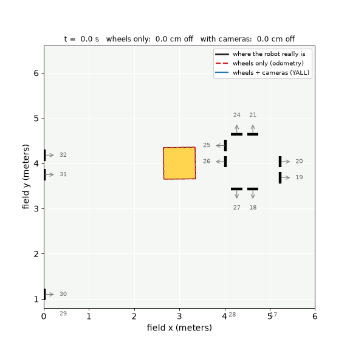

# Welcome

**YALL** (Yet Another Limelight Library) helps an FRC robot use cameras to know where it is and to find targets. It works with three kinds of cameras: **PhotonVision**, **Limelight** and **Synapse**. Your code reads every camera the same way, and when you run the robot program on your computer (in **simulation**), YALL pretends to be the camera, so you can test before you have a robot.

The black line is where a simulated robot really drove. The red dashed line is where the robot *thinks* it is from its wheels alone: it drifts about 10 cm in 10 seconds. The blue line adds three cameras through YALL and stays within about 2 cm.

## Where to start

Follow the tutorials in order:

1. [Basic Setup](tutorials/basic-setup.md): add a camera and see it find AprilTags in simulation.
2. [AprilTag Pose Estimation](tutorials/apriltag-pose-estimation.md): keep the robot's position right with cameras.
3. [Simulating Cameras](tutorials/simulating-cameras.md): match the simulated camera to yours and look through its eyes.
4. [Running on the Real Robot](tutorials/running-on-the-real-robot.md): check everything safely on real hardware.
5. [Object Detection](tutorials/object-detection.md): find game pieces.

Stuck? See [Troubleshooting](how-to-guides/troubleshooting.md).

<table data-view="cards"><thead><tr><th></th><th></th><th></th><th data-hidden data-card-target data-type="content-ref"></th></tr></thead><tbody><tr><td><h4><i class="fa-camera">:camera:</i></h4></td><td><strong>Basic Setup</strong></td><td>Add your first camera and see it work in simulation.</td><td><a href="tutorials/basic-setup.md">basic-setup.md</a></td></tr><tr><td><h4><i class="fa-location-crosshairs">:location-crosshairs:</i></h4></td><td><strong>AprilTag Pose Estimation</strong></td><td>Keep the robot's position right with cameras.</td><td><a href="tutorials/apriltag-pose-estimation.md">apriltag-pose-estimation.md</a></td></tr><tr><td><h4><i class="fa-computer">:computer:</i></h4></td><td><strong>Simulating Cameras</strong></td><td>See what the simulated camera sees.</td><td><a href="tutorials/simulating-cameras.md">simulating-cameras.md</a></td></tr><tr><td><h4><i class="fa-robot">:robot:</i></h4></td><td><strong>Running on the Real Robot</strong></td><td>Check every piece safely on real hardware.</td><td><a href="tutorials/running-on-the-real-robot.md">running-on-the-real-robot.md</a></td></tr></tbody></table>

## Words you'll see

| Word | Meaning |
| --- | --- |
| AprilTag | A square black and white code on the field. Each has an ID and a known spot. |
| Pose | Where the robot is (x and y in meters) and which way it faces. |
| Odometry | Working out the pose by counting how far the wheels turned. It drifts. |
| Pose estimator | WPILib code that mixes odometry with camera guesses to keep the pose right. |
| Yaw and pitch | How far a target is right (+) or left (−), and up (+) or down (−), of the crosshair, in degrees. |
| Field of view | How wide and how tall a camera sees, in degrees. |
| Latency | The delay between taking a picture and the result reaching your code. |
| Standard deviation | How far off a guess might be. Smaller means trust it more. |
| Simulation | Running the robot program on your computer with a pretend robot and field. |
| Vendordep | A library you add to a WPILib project, like YALL or PhotonLib. |

## The rest of this site

* **How-To Guides**: short answers to "how do I...?" questions.
* **Tuning**: making the camera and your code work well, with links to PhotonVision's and Limelight's own guides.
* **Understanding**: how YALL's results, pose filter and wrappers work.
* **API Reference**: every class and method.
