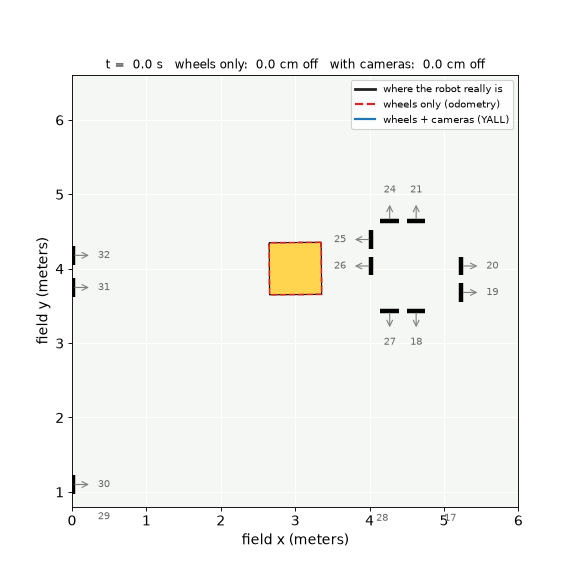

# Example Robots

YALL's repository has three complete robot projects under [`examples/`](https://github.com/Yet-Another-Software-Suite/YALL/tree/main/examples). Each one runs in simulation, so you can watch the cameras correct the robot's position without a robot or a camera.

| Example | Robot | Cameras | Framework |
| --- | --- | --- | --- |
| [`kitbot`](https://github.com/Yet-Another-Software-Suite/YALL/tree/main/examples/kitbot) | A simulated kitbot whose wheels slip, so odometry alone drifts | A Luma P1 (PhotonVision) on the front, a Limelight 4 on the back, a Synapse camera on the left | `TimedRobot`, without commands |
| [`yagsl-commands2`](https://github.com/Yet-Another-Software-Suite/YALL/tree/main/examples/yagsl-commands2) | A [YAGSL](https://docs.yagsl.com) swerve drive | A PhotonVision camera on the front, a MegaTag2 Limelight 4 on the back | Commands v2 |
| [`yagsl-commands3`](https://github.com/Yet-Another-Software-Suite/YALL/tree/main/examples/yagsl-commands3) | The same YAGSL swerve drive | The same two cameras | Commands v3 |

The kitbot example, driving: black is where the robot really is, red is its wheels alone, and blue adds the three cameras.

## What each one shows

* **`kitbot`**: one camera from each vendor in one [`VisionSystem`](https://yall.yassrobotics.com/api-reference/java-reference/yall/vision-system), feeding a WPILib pose estimator. The Field widget shows `Robot` (odometry plus cameras), `Odometry` (wheels alone) and `Truth` (where the simulated robot really is). Its test drives an arc and checks the cameras keep the estimate closer to the truth than odometry alone. The [AprilTag Pose Estimation](tutorials/apriltag-pose-estimation.md) tutorial builds a smaller version of it.
* **`yagsl-commands2` and `yagsl-commands3`**: cameras on a YAGSL swerve drive, kept in the swerve drive itself. Every loop, right after the drive updates its odometry, it gives the cameras its odometry heading and yaw rate, then adds each accepted estimate with `addVisionMeasurement`. The Limelight 4 skips frames while the robot is disabled, following [Limelight's thermal management advice](https://docs.limelightvision.io/docs/docs-limelight/getting-started/limelight-4), so it stays cool. Their tests run the robot in simulation and check the cameras see tags and agree with the simulated robot. The YAMS SwerveDrive tabs of the [AprilTag Pose Estimation](tutorials/apriltag-pose-estimation.md) tutorial use the same code.

Every example also logs its cameras to a [DataLog](understanding/telemetry.md#logging-to-a-datalog), under `YALL/<camera name>`, next to NetworkTables. The YAGSL examples log the swerve drive under `swerve/` too. In simulation the log is in the example's `logs/` folder; open it in AdvantageScope.

## Run one



### Get the code

Clone or download [YALL's repository](https://github.com/Yet-Another-Software-Suite/YALL), and open the example's folder (for example `examples/yagsl-commands2`) in WPILib VS Code.



### Simulate it

Run **WPILib: Simulate Robot Code**, or `./gradlew simulateJava` in the example's folder.



### Drive it

Drive with a gamepad on port 0 in teleop (on Commands v3, pick a teleop opmode first), and watch the robot's pose on a Field widget in AdvantageScope or Elastic. [Simulating Cameras](tutorials/simulating-cameras.md) shows how to look through the simulated cameras.



## Start your own robot from one

Each example builds YALL from the repository's source. To use one as your own project:

1. Copy the example's folder out of the repository.
2. In its `build.gradle`, delete the `srcDirs '../../yall/java'` line.
3. Install the YALL vendordep, as in [How do I install YALL?](how-to-guides/how-do-i-install-yall.md). The camera vendordeps are already in the example's `vendordeps/` folder; keep the ones for the cameras you use.
4. Give each camera its real name and its position on your robot.

Each example's README covers the rest, such as the YAGSL swerve configuration.
