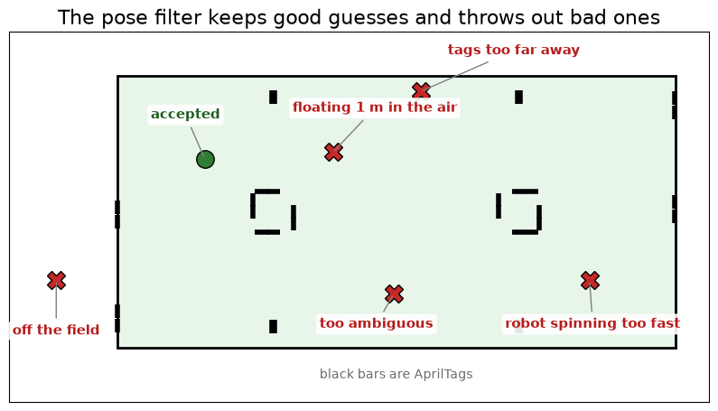

# How do I tune the pose filter?

The **pose filter** looks at every robot position a camera guesses and throws out the ones that can't be right. It also decides how much to trust the ones it keeps. The defaults work for most robots; tune it when good guesses get thrown out or bad ones get through.



Each camera's config holds a [`VisionPoseFilter`](https://yall.yassrobotics.com/api-reference/java-reference/filter/vision-pose-filter). Build one, change the checks you want, and pass it in:

```java
VisionCameraConfig config = new VisionCameraConfig()
    .withPoseFilter(new VisionPoseFilter()
        .withMaxAmbiguity(0.15)                         // tighter than the default 0.2
        .withMaxTagDistance(Meters.of(3), Meters.of(6)) // single tag, several tags
        .withMaxTilt(Degrees.of(10))                    // off by default
        .withMaxYawRate(null));                         // null turns a check off
```

Every check is set with its `withX(...)` method and turned off by passing `null`. A new [`VisionPoseFilter`](https://yall.yassrobotics.com/api-reference/java-reference/filter/vision-pose-filter) starts with the defaults below. [`VisionPoseFilter.acceptAll()`](https://yall.yassrobotics.com/api-reference/java-reference/filter/vision-pose-filter) starts with every check off; only estimates that used no tags are still rejected.

## The checks

| Method | Default | Rejects an estimate when |
| --- | --- | --- |
| `withFieldBounds(margin)` | 0.5 m | the robot would be more than the margin off the field |
| `withMaxHeightError(height)` | 0.5 m | the robot would float above or sink below the floor by more than the limit |
| `withMaxTilt(angle)` | off | the robot would be rolled or pitched past the limit |
| `withMaxAmbiguity(ambiguity)` | 0.2 | a single-tag estimate's ambiguity is above the limit |
| `withMinTagCount(count)` | 1 | fewer tags were used |
| `withMaxTagDistance(single, multi)` | 4 m / 8 m | the tags are, on average, further than the limit for its tag count |
| `withMaxYawRate(rate)` | 720 °/s | the robot spun faster than the limit (needs a yaw rate from `setRobotOrientation`) |
| `withMaxAge(age)` | 0.5 s | the image is older than the limit, or timestamped more than 50 ms in the future |
| `withMaxDistanceFromPose(pose, distance)` | off | the estimate is further than the limit from the robot's current pose |

Notes:

* **Ambiguity** applies only to single-tag estimates, and only when the camera reports ambiguity. Synapse doesn't, so its estimates skip this check.
* **Tag distance**: the two limits turn off separately. `withMaxTagDistance(null, Meters.of(8))` lets single-tag estimates through at any distance.
* **Tilt**: leave it off if the robot drives over ramps or bumps.
* **Pose jump**: turn it on only once the robot knows where it is, or vision can never correct a bad starting pose:

  ```java
  filter.withMaxDistanceFromPose(poseEstimator::getEstimatedPosition, Meters.of(1));
  ```

Read a check's setting back with its getter, which returns an `Optional` that is empty when the check is off:

```java
Optional<AngularVelocity> maxYawRate = filter.getMaxYawRate();
Optional<Distance> singleTagLimit = filter.getMaxSingleTagDistance();
```

## How much to trust accepted estimates

A **standard deviation** says how far off a guess might be: small means "trust it a lot". The pose estimator uses it to decide how much each guess moves the robot's position.

Accepted estimates get standard deviations for x, y and heading:

```
stdDev = base * (1 + d² / divisor)
```

where `d` is the average tag distance in meters. The defaults are a base of `(4 m, 4 m, 8 rad)` for one tag, `(0.5 m, 0.5 m, 1 rad)` for several, and a divisor of 30. Change them with:

```java
filter.withStdDevs(
    VecBuilder.fill(2, 2, 4),       // single tag: x, y (m), heading (rad)
    VecBuilder.fill(0.3, 0.3, 0.6), // several tags
    20);                            // smaller divisor: distant tags count for less
```

Heading-assisted estimates (MegaTag2, PhotonVision's trig solve) take their heading from the gyro, so their heading standard deviation is fixed at 1,000,000 rad. Change it with `withHeadingAssistedThetaStdDev(Radians.of(...))`.

Measure your camera's real values instead of guessing: [Measuring Standard Deviations](../tutorials/measuring-standard-deviations.md).

## Adding your own check

Add a check with a name and a test that returns true to keep a guess:

```java
filter.withCustomCheck("not in our half", estimate -> estimate.pose().getX() < 8.27);
```

The name is required. It is the rejection reason, and it is counted under `YALL/<camera name>/stats/rejectedBy/not in our half`, so a custom check never throws guesses out without you seeing it. Pass `null` as the test to remove the check.

## Finding the right values



### Watch what it keeps and throws out

Show `YALL/<camera name>/acceptedPoses` and `rejectedPoses` on a field view in AdvantageScope or Elastic, with `rejectionReason` next to it. Add `stats/acceptanceRate` and the counts under `stats/rejectedBy` to see which check throws out the most.

**Check it:** accepted poses (kept guesses) sit on the robot.



### Drive around and adjust the checks

If good guesses are thrown out, loosen the check named in `rejectionReason`. If bad guesses get through, tighten the check that should have caught them.

**Check it:** rejected poses are the ones far from the robot.



### Adjust the trust

Measure the standard deviations, as in [Measuring Standard Deviations](../tutorials/measuring-standard-deviations.md). Then, if the pose estimate still jumps when a camera sees a tag, raise them; if it's slow to fix drift, lower them.

**Check it:** the estimate stays smooth and on the robot while you drive.



## Using Limelight's own filter instead

A Limelight can use LimelightLib's `PoseEstimateConfig` in place of YALL's filter. See [How do I use vendor-specific settings?](how-do-i-use-vendor-specific-settings.md#pose-estimate-config)

## Read more

* [Pose Estimation & Filtering](../understanding/pose-estimation-and-filtering.md)
* [Telemetry](../understanding/telemetry.md)
