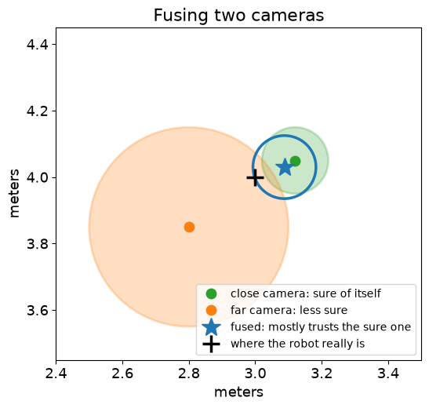

# How do I use multiple cameras?

More cameras see more AprilTags, so the robot knows where it is more often.


Put the cameras in a `VisionSystem`. They can be any mix of vendors.

```java
VisionCamera front = new PhotonVisionWrapper(new PhotonCamera("front"), frontConfig);
VisionCamera back = new LimelightWrapper(new Limelight("limelight-back"), backConfig);
VisionCamera side = new SynapseWrapper(new SynapseCamera("side"), sideConfig);

VisionSystem vision = new VisionSystem(front, back, side);
```

Give every camera its own name and its own `withRobotToCamera`. Each camera keeps its own config, so each can have its own pose estimation mode and pose filter.

## Every loop

In `Robot.java` (Commands v2 or v3):

```java
@Override
public void robotPeriodic() {
  poseEstimator.update(gyro.getRotation2d(), getModulePositions());

  vision.setRobotOrientation(gyro.getRotation3d(), DegreesPerSecond.of(gyroYawRateDegreesPerSecond));
  vision.update();
  vision.addVisionMeasurements(poseEstimator);
}

@Override
public void simulationPeriodic() {
  vision.updateSimulation(drivetrainSim.getPose());
}
```

* `update()` updates every camera.
* `addVisionMeasurements` adds every accepted estimate from every camera to the pose estimator, oldest first, each with its own timestamp and standard deviations.
* `getEstimatedPoses()` returns the same list, and `forEachEstimatedPose(...)` passes each to your own code.

This is the most accurate way to use several cameras: the pose estimator weighs each estimate at the moment its image was taken.

## One fused pose



For code that wants a single answer (a dashboard, a "where am I" check before auto), `getFusedPose()` combines each camera's newest accepted estimate:

```java
vision.getFusedPose().ifPresent(fused -> field.getObject("Vision").setPose(fused.pose2d()));
```

* Each axis is a weighted average, weighted by one over the square of the estimate's standard deviation, so trusted cameras count for more. Headings are averaged correctly across ±180°.
* Estimates more than 0.1 s older than the newest are left out. Change that with `withMaxFusionTimeSkew(Seconds.of(0.2))`.
* The fused estimate is named `"fused"`, lists every tag the cameras used, and has standard deviations of `1 / sqrt(sum of 1/σ²)` per axis.
* `VisionSystem` publishes it to NetworkTables as `YALL/fusedPose`.

It is empty when no camera had an accepted estimate in the last `update()`.

## Several Limelights

Give each Limelight its own hostname in its web interface (for example `limelight-front`, `limelight-back`), and use that name in `new Limelight(...)`. On a SystemCore, USB-connected Limelights use `Limelight.SYSTEMCORE_USB0` to `SYSTEMCORE_USB3`.

## Read more

* [AprilTag Pose Estimation tutorial](../tutorials/apriltag-pose-estimation.md)
* [Pose Estimation & Filtering](../understanding/pose-estimation-and-filtering.md)
