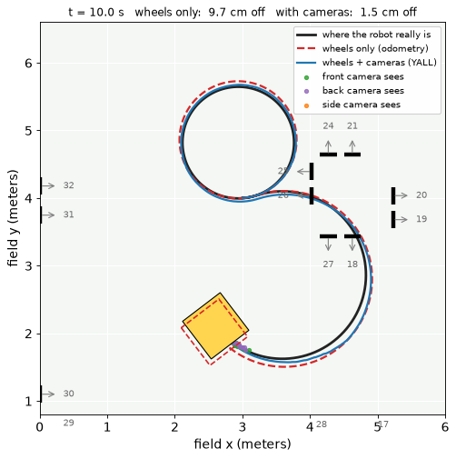
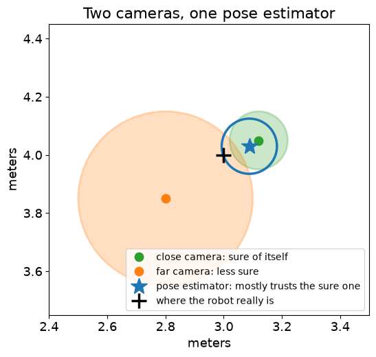

# How do I use multiple cameras?

More cameras see more AprilTags, so the robot knows where it is more often.



Put the cameras in a [`VisionSystem`](https://yall.yassrobotics.com/api-reference/java-reference/yall/vision-system). They can be any mix of vendors.

```java
VisionCamera front = new PhotonVisionWrapper(new PhotonCamera("front"), frontConfig);
VisionCamera back = new LimelightWrapper(new Limelight("limelight-back"), backConfig);
VisionCamera side = new SynapseWrapper(new SynapseCamera("side"), sideConfig);

VisionSystem vision = new VisionSystem(front, back, side);
```

Give every camera its own name and its own `withRobotToCamera`. Each camera keeps its own config, so each can have its own pose estimation mode and pose filter.

## Every loop

In `Robot.java` (Commands v2 or v3):

```java
@Override
public void robotPeriodic() {
  poseEstimator.update(gyro.getRotation2d(), getModulePositions());

  vision.setRobotOrientation(
      poseEstimator.getEstimatedPosition().getRotation(),
      DegreesPerSecond.of(gyroYawRateDegreesPerSecond));
  vision.update();
  vision.addVisionMeasurements(poseEstimator);
}

@Override
public void simulationPeriodic() {
  vision.updateSimulation(drivetrainSim.getPose());
}
```

* `update()` updates every camera.
* `addVisionMeasurements` calls your pose estimator's `addVisionMeasurement` once for every accepted estimate from every camera, oldest first, each with its own timestamp and standard deviations.
* `getEstimatedPoses()` returns the same list, and `forEachEstimatedPose(...)` passes each to your own code.

## Drivetrains with their own `addVisionMeasurement`

A YAMS `SwerveDrive`, a CTRE swerve drivetrain and most drivetrain libraries keep their own pose estimator and give you an `addVisionMeasurement` method. Pass each estimate to it:

```java
vision.update();
vision.forEachEstimatedPose(
    estimate ->
        swerveDrive.addVisionMeasurement(
            estimate.pose2d(), estimate.timestampSeconds(), estimate.stdDevs()));
```

## How to use `addVisionMeasurement`



* **Every estimate, one at a time.** Don't average the cameras or pick the best one first. The pose estimator weighs each estimate against its odometry, so the camera it trusts more pulls harder, as in the picture.
* **The estimate's own `timestampSeconds()`, never the current time.** Each image was taken a few milliseconds ago, and each camera at a different moment. The pose estimator keeps a short history of odometry and applies each estimate where the robot was when its image was taken. Combining estimates first would give them one timestamp, so some of them would land in the wrong place while the robot moves.
* **The estimate's own `stdDevs()`.** The [pose filter](../understanding/pose-estimation-and-filtering.md) sets them from tag distance and tag count. A close, multi-tag estimate pulls hard; a far, single-tag one barely moves the pose.
* **Once per loop, after `update()`.** Update odometry, then the cameras, then add the estimates. The pose estimator's `getEstimatedPosition()` (or your drivetrain's `getPose()`) is the robot's pose: odometry and every camera together.

## Several Limelights

Give each Limelight its own hostname in its web interface (for example `limelight-front`, `limelight-back`), and use that name in `new Limelight(...)`. On a SystemCore, USB-connected Limelights use `Limelight.SYSTEMCORE_USB0` to `SYSTEMCORE_USB3`.

## Read more

* [AprilTag Pose Estimation tutorial](../tutorials/apriltag-pose-estimation.md)
* [Pose Estimation & Filtering](../understanding/pose-estimation-and-filtering.md)
