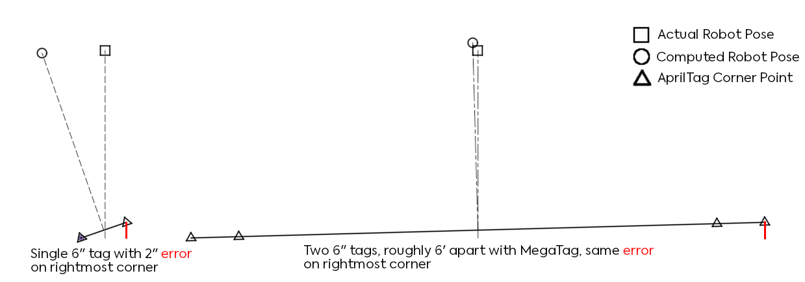

# AprilTag & MegaTag2 Localization Tuning

This page covers the setup steps that make Limelight MegaTag2 robot localization accurate, on top of the basic wiring already covered in the [AprilTag Pose Estimation tutorial](../tutorials/apriltag-pose-estimation.md) and [How do I choose a pose estimation mode?](../how-to-guides/how-do-i-choose-a-pose-estimation-mode.md) In YALL, MegaTag2 is a `LimelightWrapper` with `PoseEstimationMode.HEADING_ASSISTED`.

The field map, IMU and assist alpha steps are Limelight-specific. The camera offset, robot orientation and filtering steps apply to every camera.

## Why MegaTag beats single-tag pose

A single AprilTag's pose solve is sensitive to noise and near-symmetric ambiguity. MegaTag fuses keypoints from every visible tag into one combined solve, which is far more stable: the more tags and the more spread out they are, the better constrained the result:

<figure><figcaption><p>MegaTag fuses keypoints across all visible tags. Real-world results are even better than this simplified planar diagram suggests.</p></figcaption></figure>

This is why YALL's [pose filter](../understanding/pose-estimation-and-filtering.md) gives multi-tag estimates much smaller standard deviations than single-tag ones, and checks ambiguity only on single-tag estimates: more, more-spread-out tags is what makes MegaTag reliable in the first place.

## Prerequisites checklist

1. **Camera offset**: `withRobotToCamera(...)` in the camera's config, measured accurately from the robot's center. YALL sends it to the Limelight, overriding the web interface's camera pose. Every localization result is only as good as this offset.
2. **Field map**: upload the correct `.fmap` for the season's field to the Limelight.
3. **Blue-corner origin**: MegaTag2 (2024+) always uses the blue-corner field origin; a mismatched origin convention silently rotates/flips every pose.
4. **Robot orientation every loop**: `camera.setRobotOrientation(...)` (or `VisionSystem.setRobotOrientation(...)`) must be called every periodic loop, *before* `update()`. This is the single most common MegaTag2 mistake. Skip it and you get stale or inaccurate poses with no error thrown.

## Tuning the internal IMU (Limelight 4)

LimelightLib's `IMUMode` controls how the Limelight 4's internal IMU interacts with the orientation YALL sends from `setRobotOrientation`. Set it on the `Limelight` from the wrapper's `getCamera()`:

| `IMUMode` | Behavior | When to use |
| --- | --- | --- |
| `EXTERNAL` | Internal IMU ignored entirely; MT2 uses only the orientation you send. | Simplest option; fine if your external gyro is trustworthy every loop. |
| `EXTERNAL_SEED_INTERNAL` | Uses the orientation you send, and keeps seeding the internal IMU with it. | Good default while disabled/pre-match. |
| `INTERNAL` | Internal IMU drives MT2; the orientation you send is ignored. | Rarely, only if you have no reliable external gyro. |
| `INTERNAL_MT1_ASSIST` | Internal IMU drives MT2, continuously corrected toward the MegaTag1 (vision-only) yaw. | Enabled, vision-heavy matches; gentle correction without needing a gyro. |
| `INTERNAL_EXTERNAL_ASSIST` | Internal IMU drives MT2, continuously corrected toward the orientation you send. | Enabled: a good default once your gyro is confirmed working, more robust to a single bad gyro read than `EXTERNAL`. |

A common pattern: seed with `EXTERNAL_SEED_INTERNAL` while disabled, then switch to an assist mode once enabled:

```java
Limelight limelight = limelightCamera.getCamera();

@Override
public void disabledInit() {
    limelight.setIMUMode(IMUMode.EXTERNAL_SEED_INTERNAL);
}

@Override
public void teleopInit() {
    limelight.setIMUMode(IMUMode.INTERNAL_EXTERNAL_ASSIST);
}
```

### Complementary filter alpha

`limelight.setIMUAssistAlpha(alpha)` (default `0.001`) controls how fast the internal IMU converges toward whichever assist source is active:

* **Lower**: the internal IMU stays stable but corrects drift slowly.
* **Higher**: corrects drift faster, at the cost of reacting more to noise in the assist source, which matters more during rapid turns.

Start at the default and only raise it if you observe heading drift the assist source isn't correcting fast enough.

## Common setup mistakes

* Forgetting `setRobotOrientation(...)` on some loop iterations (e.g. an early `return` before the call).
* No `.fmap` uploaded, or an outdated one from a previous season.
* Mounting a Limelight 4 in portrait orientation: its internal IMU requires landscape mounting.
* Assuming the field origin convention from a pre-2024 season still applies.

## See Also

* [Tuning Workflow Overview](tuning-workflow-overview.md)
* [ChArUco Camera Calibration](charuco-camera-calibration.md): accurate intrinsics are a prerequisite for accurate MegaTag poses.
* [How do I choose a pose estimation mode?](../how-to-guides/how-do-i-choose-a-pose-estimation-mode.md)
* [Pose Estimation & Filtering](../understanding/pose-estimation-and-filtering.md)
