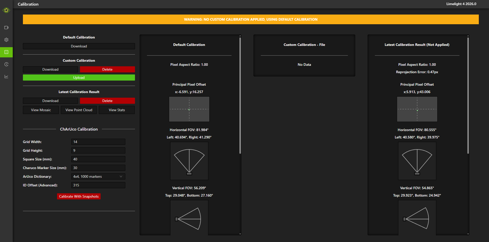

# ChArUco Camera Calibration

**Calibration** teaches the camera its exact lens: how it bends the picture and where its middle is. A ChArUco board is a printed checkerboard with small AprilTag-like markers. You take pictures of it from many angles, and the camera works out its lens from them.

* Tuning a PhotonVision camera: [Calibrating Your Camera](https://docs.photonvision.org/en/latest/docs/calibration/calibration.html) (PhotonVision's Cameras tab).
* Tuning a Limelight: [ChArUco Camera Calibration](https://docs.limelightvision.io/docs/docs-limelight/getting-started/performing-charuco-camera-calibration). The steps below follow it.

Every `VisionTarget.cameraToTarget()`, every `VisionPoseEstimate`, and AprilTag 3D tracking in general all depend on SolvePnP, which depends on an accurate camera intrinsic calibration. The factory calibration gets you close, and a ChArUco calibration done on your specific camera gets you accurate. If you're only using a target's yaw and pitch for visual servoing, you can skip this, since it's only worth doing when 3D pose accuracy matters.

## Calibrate



### Make a flat board

Print a ChArUco board, or show one on a big monitor. Measure the grid size (11 × 8 by default), square size and marker size with calipers, and note the dictionary (5x5\_100 by default): small measuring errors make the calibration wrong. Tape a printed board to something stiff, like a clipboard.

**Check it:** the board lies perfectly flat.



### Take lots of different pictures

Take **at least 25 pictures, 50 is better**:

* The board big and small in the picture.
* The board partly off the edges and corners.
* The board tilted away from the camera in about half of them.

On a Limelight: make a "Charuco Calibration Preview" pipeline, enter the board's measurements, delete old snapshots, then take the new ones.

**Check it:** you have 25 or more pictures that look different from each other.



### Run the calibration

On a Limelight, open the **Calibration** tab and click **Calibrate with Snapshots** (1 to 2 minutes). Save the calibration file.

**Check it:** the results match "What good looks like" below.



## What "good" looks like

| Metric | Good | Investigate if |
| --- | --- | --- |
| Reprojection error | under 1 px (0.3 to 0.8 is typical) | Consistently > 1 px: board is likely warped or the marker measurements are off |
| Pixel aspect ratio | about 1.0 (0.99 to 1.01 is fine) | Noticeably off 1.0: same causes as above |

A good calibration's per-image reprojection error plot is tight and evenly scattered around zero. A warning-level calibration shows a visibly larger spread, which is your cue to redo the capture pass with more foreshortened images or a flatter board:

<figure><figcaption>
A good calibration: low, tightly scattered reprojection error.
</figcaption></figure>

<figure><figcaption>
A flagged calibration: wider error spread, worth recapturing.
</figcaption></figure>

## Read more

* [Tuning Workflow Overview](tuning-workflow-overview.md)
* [Pose Estimation & Filtering](../understanding/pose-estimation-and-filtering.md)
* [AprilTag Localization Tuning](apriltag-and-megatag2-tuning.md)
