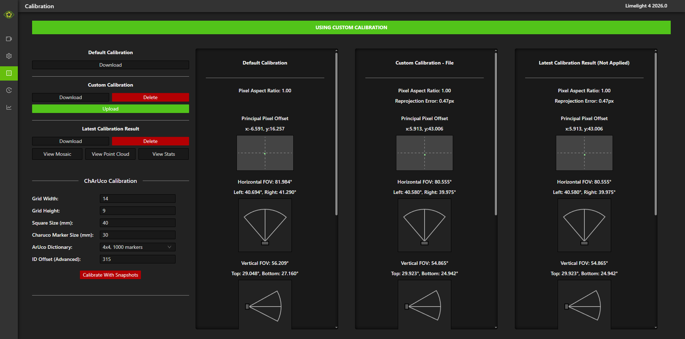

# ChArUco Camera Calibration

Every `getXXXPose_YYYSpace()` call on `AprilTagFiducial`/`RetroreflectiveTape`, every `PoseEstimate` from `LimelightPoseEstimator`, and AprilTag 3D tracking in general all depend on SolvePnP, which depends on an accurate camera intrinsic calibration. The factory calibration gets you close; a ChArUco calibration done on your specific camera gets you accurate. If you're only using `tx`/`ty` for visual servoing, you can skip this, since it's only worth doing when 3D pose accuracy matters.

## Prepare the board

1. Print a ChArUco board, or display one on a large monitor.
2. Measure and record: grid width and height (count black squares + ArUco markers per row/column; 11×8 is the default board), square size, marker size, and dictionary type (5x5\_100 is the default). **Use calipers** for the square/marker size measurements, since small errors here directly bias the calibration.
3. If printed, mount the board on something rigid (a clipboard works). A warped board produces a bad calibration no matter how many images you capture.

## Capture images

Capture **at least 25 images, 50+ recommended**, with deliberate variety:

* The board filling large and small regions of the frame.
* The board partially off-screen, extending past image edges/corners.
* The board at an angle to the camera, not just parallel to the image plane. Roughly half your captures should show significant foreshortening.

## Run the calibration

1. Create a "Charuco Calibration Preview" pipeline and enter the board settings from step 2 above.
2. Delete any existing snapshots, then capture your new, varied set of images.
3. Go to the **Calibration** tab and click **Calibrate with Snapshots**. This takes 1–2 minutes.
4. Check the results, then download/upload the calibration file to persist it.

## What "good" looks like

| Metric             | Good                         | Investigate if                                                                 |
| ------------------ | ---------------------------- | ------------------------------------------------------------------------------ |
| Reprojection error | < 1 px (0.3–0.8 typical)     | Consistently > 1 px: board is likely warped or the marker measurements are off |
| Pixel aspect ratio | \~1.0 (0.99–1.01 acceptable) | Noticeably off 1.0: same causes as above                                       |

A good calibration's per-image reprojection error plot is tight and evenly scattered around zero. A warning-level calibration shows a visibly larger spread, which is your cue to redo the capture pass with more foreshortened images or a flatter board:

<figure><figcaption>
A good calibration: low, tightly scattered reprojection error.
</figcaption></figure>

<figure><figcaption>
A flagged calibration: wider error spread, worth recapturing.
</figcaption></figure>

## See Also

* [Tuning Workflow Overview](tuning-workflow-overview.md)
* [Pose Estimation & Ambiguity](../understanding/pose-estimation-and-ambiguity.md)
* [AprilTag & MegaTag2 Localization Tuning](apriltag-and-megatag2-tuning.md)
