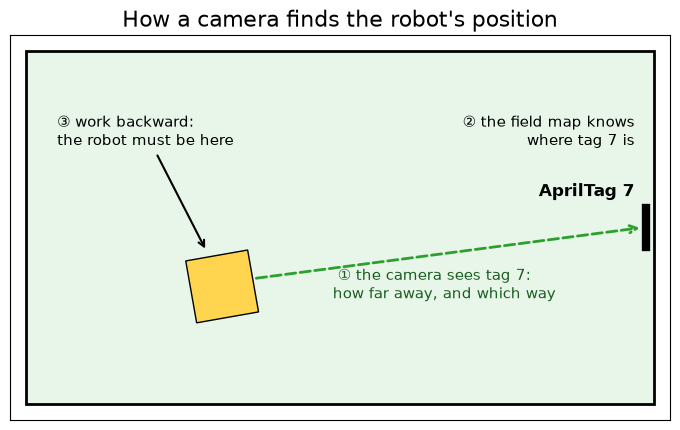
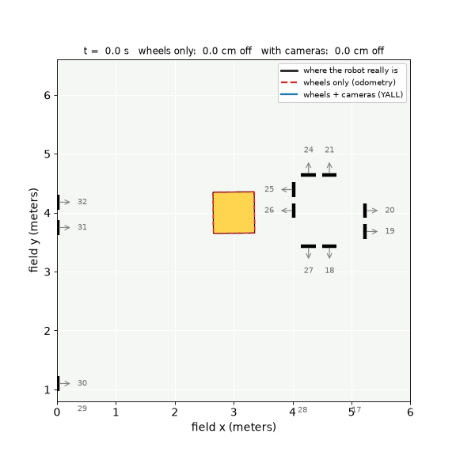

# AprilTag Pose Estimation

In this tutorial a simulated robot drives in a circle while a camera keeps its position correct. You'll see the difference cameras make.

## Before you start

* Finish [Basic Setup](basic-setup.md).
* A few words you'll need:
  * **Odometry** works out where the robot is by counting how far the wheels turned. It drifts: wheels slip, so small errors add up over a match.
  * A **pose estimator** (WPILib's `SwerveDrivePoseEstimator` or `DifferentialDrivePoseEstimator`) mixes odometry with camera guesses to keep the pose right.
  * A **standard deviation** says how much to trust a guess: small means "trust it a lot", big means "barely trust it". YALL works these out for you.





### Make odometry and a pose estimator

This tutorial uses a simulated kitbot whose wheels slip 5%, so you can watch odometry drift. On your robot, use your drivetrain's encoders, gyro and pose estimator instead.

```java
private static final double WHEEL_SLIP = 1.05;
private final Pose2d startPose = new Pose2d(3, 4, Rotation2d.ZERO);
private final DifferentialDrivetrainSim drivetrainSim =
    DifferentialDrivetrainSim.createKitbotSim(
        KitbotMotor.DUAL_CIM_PER_SIDE, KitbotGearing.RATIO_10P71, KitbotWheelSize.SIX_INCH, null);
private final DifferentialDrivePoseEstimator poseEstimator =
    new DifferentialDrivePoseEstimator(Rotation2d.ZERO, 0, 0, startPose);
```

**Check it:** the project builds.



### Add the camera's guesses to the pose estimator

Every loop: update odometry, give the camera the gyro heading, read the camera, then add its guesses.

```java
@Override
public void robotPeriodic() {
  Rotation2d heading = drivetrainSim.getHeading(); // on a real robot: the gyro
  poseEstimator.update(heading,
      drivetrainSim.getLeftPosition() * WHEEL_SLIP,
      drivetrainSim.getRightPosition() * WHEEL_SLIP);

  camera.setRobotOrientation(heading);
  camera.update();
  camera.addVisionMeasurements(poseEstimator);
}
```

`addVisionMeasurements` adds every guess that passed the pose filter, oldest first, each with the time its picture was taken and its standard deviations.

**Check it:** the project builds.



### Drive in simulation

Make the simulated robot drive a slow circle, and tell the simulated world where it really is:

```java
@Override
public void simulationPeriodic() {
  drivetrainSim.setInputs(4, 6); // volts: left, right
  drivetrainSim.update(0.02);
  VisionSim.getDefault().update(drivetrainSim.getPose());
}
```

Always give the simulation the robot's **true** pose, never the pose estimator's guess.

**Check it:** run the simulation and enable the robot. It drives in a circle.



### Watch the poses on a field

Show the estimate and the truth on a `Field2d`, then open `Field` in your dashboard:

```java
field.setRobotPose(poseEstimator.getEstimatedPosition());
field.getObject("Truth").setPose(drivetrainSim.getPose());
Telemetry.log("Field", field);
```

**Check it:** the robot and `Truth` stay on top of each other.

Here's the same idea with three cameras from YALL's example robot. Black is where the robot really is. Red is wheels only: it drifts about 10 cm in 10 seconds. Blue is wheels plus cameras: it stays within about 2 cm. The dots are each camera's guesses.






**Why `Robot.java`?** YALL doesn't use the command framework, so it works the same with Commands v2 and Commands v3. Both robot classes, `TimedRobot` (Commands v2) and `OpModeRobot` (Commands v3), have `robotPeriodic()`, which runs every loop, and `simulationPeriodic()`, which runs every loop in simulation. Commands v3 mechanisms have no `simulationPeriodic()`, so `Robot.java` is the one place that works for both.


## How it decides what to trust

Every guess goes through the camera's pose filter first. The filter throws out guesses that can't be right, like a robot off the field or floating in the air, and gives the rest standard deviations: closer tags and more tags mean more trust. To see what it threw out and why, look at `YALL/front/rejectedPoses` and `YALL/front/rejectionReason`. To change it, see [How do I tune the pose filter?](../how-to-guides/how-do-i-tune-the-pose-filter.md)

## If it did not work

* **The estimate drifts like odometry:** the camera sees no tags, or the filter throws out every guess. Check `YALL/front/targetCount` and `YALL/front/rejectionReason`.
* **The estimate jumps around:** the camera offset is wrong. Measure it again, as in [Basic Setup](basic-setup.md).
* **More problems:** [Troubleshooting](../how-to-guides/troubleshooting.md).

## The complete file



`first/robot/Robot.java`:

```java
package first.robot;

import static org.wpilib.units.Units.Degrees;
import static org.wpilib.units.Units.Inches;

import org.photonvision.PhotonCamera;
import org.wpilib.framework.TimedRobot;
import org.wpilib.math.estimator.DifferentialDrivePoseEstimator;
import org.wpilib.math.geometry.Pose2d;
import org.wpilib.math.geometry.Rotation2d;
import org.wpilib.simulation.DifferentialDrivetrainSim;
import org.wpilib.simulation.DifferentialDrivetrainSim.KitbotGearing;
import org.wpilib.simulation.DifferentialDrivetrainSim.KitbotMotor;
import org.wpilib.simulation.DifferentialDrivetrainSim.KitbotWheelSize;
import org.wpilib.smartdashboard.Field2d;
import org.wpilib.telemetry.Telemetry;
import yall.VisionCamera;
import yall.VisionCameraConfig;
import yall.cameras.PhotonVisionWrapper;
import yall.sim.CameraModel;
import yall.sim.VisionSim;

public class Robot extends TimedRobot {
  // The simulated wheels slip 5%, so wheel odometry alone slowly drifts, like on a real robot.
  private static final double WHEEL_SLIP = 1.05;

  private final Pose2d startPose = new Pose2d(3, 4, Rotation2d.ZERO);

  // A simulated kitbot. On a real robot, use your drivetrain instead.
  private final DifferentialDrivetrainSim drivetrainSim =
      DifferentialDrivetrainSim.createKitbotSim(
          KitbotMotor.DUAL_CIM_PER_SIDE, KitbotGearing.RATIO_10P71, KitbotWheelSize.SIX_INCH, null);

  // Mixes wheel odometry with camera poses.
  private final DifferentialDrivePoseEstimator poseEstimator =
      new DifferentialDrivePoseEstimator(Rotation2d.ZERO, 0, 0, startPose);

  private final VisionCamera camera =
      new PhotonVisionWrapper(
          new PhotonCamera("front"),
          new VisionCameraConfig()
              .withCameraModel(CameraModel.LUMA_P1)
              .withRobotToCamera(
                  Inches.of(12), Inches.zero(), Inches.of(12),
                  Degrees.zero(), Degrees.of(-10), Degrees.zero()));

  private final Field2d field = new Field2d();

  public Robot() {
    drivetrainSim.setPose(startPose);
  }

  @Override
  public void robotPeriodic() {
    // On a real robot, these come from the gyro and the wheel encoders.
    Rotation2d heading = drivetrainSim.getHeading();
    double left = drivetrainSim.getLeftPosition() * WHEEL_SLIP;
    double right = drivetrainSim.getRightPosition() * WHEEL_SLIP;
    poseEstimator.update(heading, left, right);

    camera.setRobotOrientation(heading);
    camera.update();
    camera.addVisionMeasurements(poseEstimator);

    field.setRobotPose(poseEstimator.getEstimatedPosition());
    field.getObject("Truth").setPose(drivetrainSim.getPose());
    Telemetry.log("Field", field);
  }

  @Override
  public void simulationPeriodic() {
    // Drive a slow circle on its own: 4 V on the left wheels, 6 V on the right.
    drivetrainSim.setInputs(4, 6);
    drivetrainSim.update(0.02);
    // The camera sees the field from where the robot really is.
    VisionSim.getDefault().update(drivetrainSim.getPose());
  }
}
```



`first/robot/Robot.java`:

```java
package first.robot;

import static org.wpilib.units.Units.Degrees;
import static org.wpilib.units.Units.Inches;

import org.photonvision.PhotonCamera;
import org.wpilib.framework.OpModeRobot;
import org.wpilib.math.estimator.DifferentialDrivePoseEstimator;
import org.wpilib.math.geometry.Pose2d;
import org.wpilib.math.geometry.Rotation2d;
import org.wpilib.simulation.DifferentialDrivetrainSim;
import org.wpilib.simulation.DifferentialDrivetrainSim.KitbotGearing;
import org.wpilib.simulation.DifferentialDrivetrainSim.KitbotMotor;
import org.wpilib.simulation.DifferentialDrivetrainSim.KitbotWheelSize;
import org.wpilib.smartdashboard.Field2d;
import org.wpilib.telemetry.Telemetry;
import yall.VisionCamera;
import yall.VisionCameraConfig;
import yall.cameras.PhotonVisionWrapper;
import yall.sim.CameraModel;
import yall.sim.VisionSim;

public class Robot extends OpModeRobot {
  // The simulated wheels slip 5%, so wheel odometry alone slowly drifts, like on a real robot.
  private static final double WHEEL_SLIP = 1.05;

  private final Pose2d startPose = new Pose2d(3, 4, Rotation2d.ZERO);

  // A simulated kitbot. On a real robot, use your drivetrain instead.
  private final DifferentialDrivetrainSim drivetrainSim =
      DifferentialDrivetrainSim.createKitbotSim(
          KitbotMotor.DUAL_CIM_PER_SIDE, KitbotGearing.RATIO_10P71, KitbotWheelSize.SIX_INCH, null);

  // Mixes wheel odometry with camera poses.
  private final DifferentialDrivePoseEstimator poseEstimator =
      new DifferentialDrivePoseEstimator(Rotation2d.ZERO, 0, 0, startPose);

  private final VisionCamera camera =
      new PhotonVisionWrapper(
          new PhotonCamera("front"),
          new VisionCameraConfig()
              .withCameraModel(CameraModel.LUMA_P1)
              .withRobotToCamera(
                  Inches.of(12), Inches.zero(), Inches.of(12),
                  Degrees.zero(), Degrees.of(-10), Degrees.zero()));

  private final Field2d field = new Field2d();

  public Robot() {
    drivetrainSim.setPose(startPose);
  }

  @Override
  public void robotPeriodic() {
    // On a real robot, these come from the gyro and the wheel encoders.
    Rotation2d heading = drivetrainSim.getHeading();
    double left = drivetrainSim.getLeftPosition() * WHEEL_SLIP;
    double right = drivetrainSim.getRightPosition() * WHEEL_SLIP;
    poseEstimator.update(heading, left, right);

    camera.setRobotOrientation(heading);
    camera.update();
    camera.addVisionMeasurements(poseEstimator);

    field.setRobotPose(poseEstimator.getEstimatedPosition());
    field.getObject("Truth").setPose(drivetrainSim.getPose());
    Telemetry.log("Field", field);
  }

  @Override
  public void simulationPeriodic() {
    // Drive a slow circle on its own: 4 V on the left wheels, 6 V on the right.
    drivetrainSim.setInputs(4, 6);
    drivetrainSim.update(0.02);
    // The camera sees the field from where the robot really is.
    VisionSim.getDefault().update(drivetrainSim.getPose());
  }
}
```



## Read more

* [Pose Estimation & Filtering](../understanding/pose-estimation-and-filtering.md): how the filter and standard deviations work.
* [How do I choose a pose estimation mode?](../how-to-guides/how-do-i-choose-a-pose-estimation-mode.md): MegaTag2 and other gyro-assisted modes.
* [How do I use multiple cameras?](../how-to-guides/how-do-i-use-multiple-cameras.md)
* Tuning a PhotonVision camera for poses: [3D Tracking](https://docs.photonvision.org/en/latest/docs/apriltag-pipelines/3D-tracking.html), [MultiTag Localization](https://docs.photonvision.org/en/latest/docs/apriltag-pipelines/multitag.html) and [PhotonPoseEstimator](https://docs.photonvision.org/en/latest/docs/programming/photonlib/robot-pose-estimator.html).
* Tuning a Limelight for poses: [Robot Localization with MegaTag](https://docs.limelightvision.io/docs/docs-limelight/pipeline-apriltag/apriltag-robot-localization) and [MegaTag2](https://docs.limelightvision.io/docs/docs-limelight/pipeline-apriltag/apriltag-robot-localization-megatag2).
