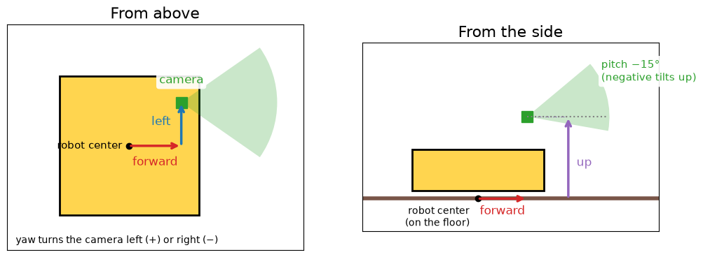
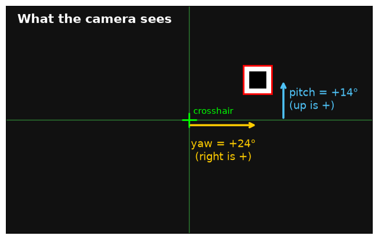

# Basic Setup

In this tutorial you add one camera to a robot program, run it in simulation, and watch it see AprilTags. It takes about 15 minutes, and you don't need a robot.

## Before you start

* Install YALL and its vendordeps: [How do I install YALL?](../how-to-guides/how-do-i-install-yall.md) A **vendordep** (vendor dependency) is a library you add to a WPILib project from the **WPILib: Manage Vendor Libraries** menu.
* You need a WPILib 2027 Java robot project. Robot code lives in the `first.robot` package, started by `first/Main.java`.

## The pieces, in one sentence each

* **A camera** ([`VisionCamera`](https://yall.yassrobotics.com/api-reference/java-reference/yall/vision-camera)) wraps your camera's own library (PhotonVision, Limelight or Synapse) so every camera works the same way.
* **Its config** ([`VisionCameraConfig`](https://yall.yassrobotics.com/api-reference/java-reference/yall/vision-camera-config)) says which camera it is and where it sits on the robot.
* **The pose filter** ([`VisionPoseFilter`](https://yall.yassrobotics.com/api-reference/java-reference/filter/vision-pose-filter)) throws out bad position guesses. It has good defaults, so you can ignore it for now.
* **The simulated world** ([`VisionSim`](https://yall.yassrobotics.com/api-reference/java-reference/sim/vision-sim)) is a pretend field full of AprilTags that every camera sees when the program runs on your computer.
* **A vision system** ([`VisionSystem`](https://yall.yassrobotics.com/api-reference/java-reference/yall/vision-system)) runs several cameras together. You need it once you have more than one camera.


**AprilTags** are the square black and white codes stuck around an FRC field. Each one has an ID number and a known spot on the field, so a camera that sees one can work out where the robot is.




### Add the camera

Open `first/robot/Robot.java` and add a camera as a field of the `Robot` class. This one is a PhotonVision camera named `front`. Use [`LimelightWrapper`](https://yall.yassrobotics.com/api-reference/java-reference/cameras/limelight-wrapper) with `new Limelight("limelight")`, or [`SynapseWrapper`](https://yall.yassrobotics.com/api-reference/java-reference/cameras/synapse-wrapper) with `new SynapseCamera("camera")`, for the other vendors.

```java
private final VisionCamera camera =
    new PhotonVisionWrapper(
        new PhotonCamera("front"),
        new VisionCameraConfig()
            .withCameraModel(CameraModel.ARDUCAM_OV9281)
            .withRobotToCamera(
                Inches.of(12), Inches.zero(), Inches.of(10),
                Degrees.zero(), Degrees.of(-15), Degrees.zero()));
```

* `withCameraModel` says which camera you have, so the simulation sees what the real one would: its **field of view** (how wide it sees) and frame rate. [Simulating Cameras](simulating-cameras.md) lists the models.
* `withRobotToCamera` says where the camera is, measured from the middle of the robot on the floor: forward, left, up, then how it is turned. This one is 12" forward, centered, 10" up and tilted 15° up.



**Check it:** the project builds (**WPILib: Build Robot Code**).



### Read the camera every loop

Call `update()` once per loop, in `robotPeriodic()`. It reads every picture the camera took since the last loop. Then log what it found:

```java
@Override
public void robotPeriodic() {
  camera.update();
  camera.getBestTarget().ifPresent(target -> {
    Telemetry.log("Vision/best tag", target.fiducialId());
    Telemetry.log("Vision/best yaw", Degrees.of(target.yawDegrees()));
    Telemetry.log("Vision/best pitch", Degrees.of(target.pitchDegrees()));
  });
}
```

**Yaw** is how far left or right of the crosshair a target is (right is positive). **Pitch** is how far up or down (up is positive).



**Check it:** the project builds.



### Give the simulation a robot pose

A **pose** is where the robot is on the field (x and y in meters) and which way it faces. In simulation there's no real camera, so YALL needs to know where the pretend robot stands. Add `simulationPeriodic()`:

```java
private static final Pose2d SIMULATED_ROBOT_POSE = new Pose2d(3.0, 4.0, Rotation2d.ZERO);

@Override
public void simulationPeriodic() {
  VisionSim.getDefault().update(SIMULATED_ROBOT_POSE);
}
```

This robot stands 3 m from the blue wall, facing the blue hub and its AprilTags.

**Check it:** the project builds.



### Run it and look

Run the simulation (**WPILib: Simulate Robot Code**) and open a dashboard such as Elastic or AdvantageScope. Look at:

* `YALL/front/targetCount`: how many targets the camera sees.
* `Vision/best tag`, `Vision/best yaw` and `Vision/best pitch`: the target closest to the crosshair.

**Check it:** `targetCount` is above 0 (it's 8 from this spot), and the best tag's yaw is close to 0, because the camera faces it.




**Why `Robot.java`?** YALL doesn't use the command framework, so it works the same with Commands v2 and Commands v3. Both robot classes, `TimedRobot` (Commands v2) and `OpModeRobot` (Commands v3), have `robotPeriodic()`, which runs every loop, and `simulationPeriodic()`, which runs every loop in simulation. Commands v3 mechanisms have no `simulationPeriodic()`, so `Robot.java` is the one place that works for both.


## If it did not work

* **The build fails on `PhotonCamera`, `Limelight` or `SynapseCamera`:** a vendordep is missing. See [How do I install YALL?](../how-to-guides/how-do-i-install-yall.md)
* **`targetCount` stays 0:** check that `simulationPeriodic()` calls [`VisionSim.getDefault().update(...)`](https://yall.yassrobotics.com/api-reference/java-reference/sim/vision-sim), and that the pose faces some AprilTags.
* **More problems:** [Troubleshooting](../how-to-guides/troubleshooting.md).

## The complete file



`first/robot/Robot.java`:

```java
package first.robot;

import static org.wpilib.units.Units.Degrees;
import static org.wpilib.units.Units.Inches;

import org.photonvision.PhotonCamera;
import org.wpilib.framework.TimedRobot;
import org.wpilib.math.geometry.Pose2d;
import org.wpilib.math.geometry.Rotation2d;
import org.wpilib.telemetry.Telemetry;
import yall.VisionCamera;
import yall.VisionCameraConfig;
import yall.cameras.PhotonVisionWrapper;
import yall.sim.CameraModel;
import yall.sim.VisionSim;

public class Robot extends TimedRobot {
  // In simulation, the robot stands still here: 3 m from the blue wall, facing the blue hub.
  private static final Pose2d SIMULATED_ROBOT_POSE = new Pose2d(3.0, 4.0, Rotation2d.ZERO);

  private final VisionCamera camera =
      new PhotonVisionWrapper(
          new PhotonCamera("front"),
          new VisionCameraConfig()
              // Which camera this is, so the simulation sees what it would.
              .withCameraModel(CameraModel.ARDUCAM_OV9281)
              // 12" forward of center, centered, 10" up, tilted 15° up.
              .withRobotToCamera(
                  Inches.of(12), Inches.zero(), Inches.of(10),
                  Degrees.zero(), Degrees.of(-15), Degrees.zero()));

  @Override
  public void robotPeriodic() {
    camera.update();
    camera
        .getBestTarget()
        .ifPresent(
            target -> {
              Telemetry.log("Vision/best tag", target.fiducialId());
              Telemetry.log("Vision/best yaw", Degrees.of(target.yawDegrees()));
              Telemetry.log("Vision/best pitch", Degrees.of(target.pitchDegrees()));
            });
  }

  @Override
  public void simulationPeriodic() {
    VisionSim.getDefault().update(SIMULATED_ROBOT_POSE);
  }
}
```



`first/robot/Robot.java`:

```java
package first.robot;

import static org.wpilib.units.Units.Degrees;
import static org.wpilib.units.Units.Inches;

import org.photonvision.PhotonCamera;
import org.wpilib.framework.OpModeRobot;
import org.wpilib.math.geometry.Pose2d;
import org.wpilib.math.geometry.Rotation2d;
import org.wpilib.telemetry.Telemetry;
import yall.VisionCamera;
import yall.VisionCameraConfig;
import yall.cameras.PhotonVisionWrapper;
import yall.sim.CameraModel;
import yall.sim.VisionSim;

public class Robot extends OpModeRobot {
  // In simulation, the robot stands still here: 3 m from the blue wall, facing the blue hub.
  private static final Pose2d SIMULATED_ROBOT_POSE = new Pose2d(3.0, 4.0, Rotation2d.ZERO);

  private final VisionCamera camera =
      new PhotonVisionWrapper(
          new PhotonCamera("front"),
          new VisionCameraConfig()
              // Which camera this is, so the simulation sees what it would.
              .withCameraModel(CameraModel.ARDUCAM_OV9281)
              // 12" forward of center, centered, 10" up, tilted 15° up.
              .withRobotToCamera(
                  Inches.of(12), Inches.zero(), Inches.of(10),
                  Degrees.zero(), Degrees.of(-15), Degrees.zero()));

  @Override
  public void robotPeriodic() {
    camera.update();
    camera
        .getBestTarget()
        .ifPresent(
            target -> {
              Telemetry.log("Vision/best tag", target.fiducialId());
              Telemetry.log("Vision/best yaw", Degrees.of(target.yawDegrees()));
              Telemetry.log("Vision/best pitch", Degrees.of(target.pitchDegrees()));
            });
  }

  @Override
  public void simulationPeriodic() {
    VisionSim.getDefault().update(SIMULATED_ROBOT_POSE);
  }
}
```



Pick a target the robot should drive toward with its yaw, as in [PID Tuning for Aiming & Ranging](../tuning/pid-tuning-for-aiming-and-ranging.md).
