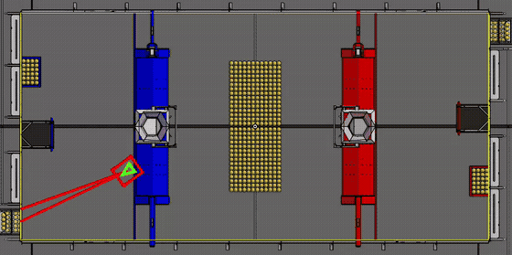
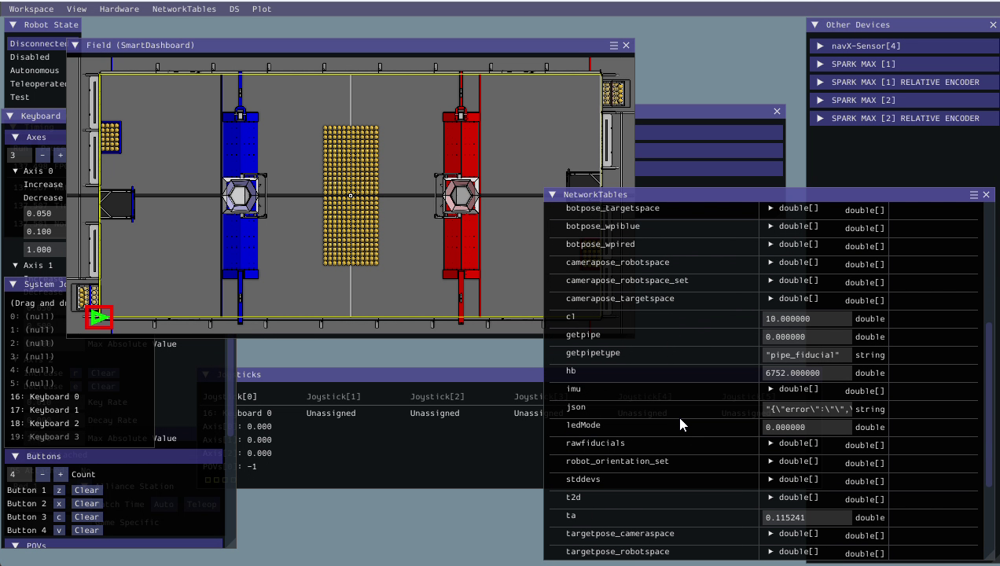
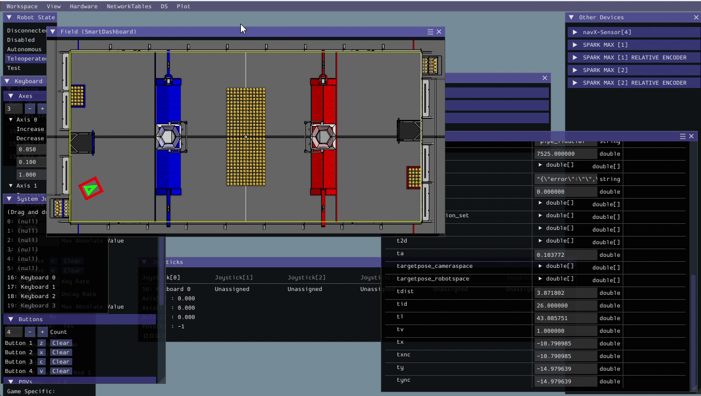
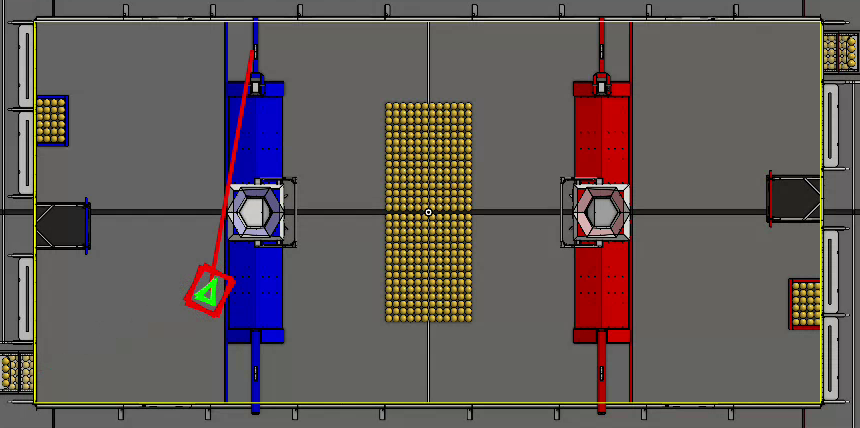
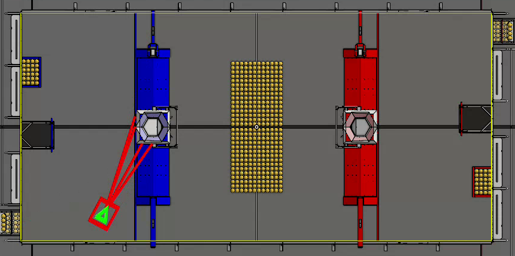

# Simulating a Limelight

This tutorial adds a simulated Limelight to your robot code so that vision dependent behavior (aiming, MegaTag pose fusion, object reactions) can be exercised in desktop simulation without physical hardware.

* `LimelightSim` projects AprilTags from the current season's field onto a simulated camera.
* It publishes the same NetworkTables keys real Limelight hardware would.
  * Nothing downstream (`LimelightData`, `LimelightTargetData`, `LimelightPoseEstimator`) needs to know it isn't talking to a real camera.


The overall design (a per camera simulation object fed the robot's ground truth pose every loop, projecting field targets into a camera model to publish simulated output) is based on PhotonVision's `VisionSystemSim`/`PhotonCameraSim` classes. Credit to the PhotonVision project for that approach. YALL's implementation is a self contained port of the idea onto the Limelight NetworkTables schema and does not depend on PhotonVision at runtime.


<figure><figcaption><p>The robot driving around the field in desktop simulation, with <code>withField2d</code> drawing a raycast to every AprilTag currently in view.</p></figcaption></figure>

## 1. Create the LimelightSim

* Construct one `LimelightSim` per `Limelight`, right next to where you construct the `Limelight` itself:

```java
import limelight.Limelight;
import limelight.sim.LimelightSim;

Limelight limelight = new Limelight("limelight");
LimelightSim limelightSim = new LimelightSim(limelight);
```

* No further configuration is required. By default `LimelightSim`:
  * Loads the current season's official AprilTag field.
  * Assumes the camera sits at the robot's origin.
  * Uses Limelight 3 like resolution, field of view, latency, and noise.

## 2. Match the camera offset you already configured

* If you called `withCameraOffset` on the real `Limelight`, give the simulation the same transform so the simulated camera looks out from the same point:

```java
limelightSim.withRobotToCameraTransform(
    new Transform3d(cameraOffset.getTranslation(), cameraOffset.getRotation()));
```

* The translation is the camera's offset from the center of the robot, in meters, not from any other reference point on the chassis.

## 3. Update it from simulationPeriodic

* Feed it the robot's ground truth pose (from your drivetrain simulation) every simulation loop:

```java
@Override
public void simulationPeriodic() {
    limelightSim.update(driveSimulation.getSimulatedDriveTrainPose());
}
```

* That's it. From the simulated pose, `LimelightSim` updates:
  * `tx`/`ty`/`ta`/`tv`/`tid`
  * every `botpose*` variant
  * `rawfiducials`
  * `t2d`
  * the target/camera relative poses
  * the `json` results blob
  * the same as they would from a real Limelight watching the same field.

### Finding a ground truth pose from a YAMS SwerveDrive

* If your drivetrain is a YAMS `SwerveDrive`, `getPose()` is the same kind of thing `DifferentialDrivePoseEstimator.getEstimatedPosition()` is for a tank drive: the fused odometry estimate, not ground truth.
  * Feeding it back into `LimelightSim.update(...)` would make the simulated camera and the pose estimator each assume the other is correct, so vision correction would never actually show up as a change.
* YAMS now exposes `SwerveDrive#getSimPose()`, which already tracks this same ground truth pose for you. Prefer it over the manual integration below when it's available.
* The manual approach below is still worth knowing for tank drives or older YAMS versions without `getSimPose()`: integrate `SwerveDrive#getDesiredChassisSpeeds()` into a separate pose every simulation loop:

```java
Pose2d simulatedPose = Pose2d.kZero;
double lastTimestampSeconds = Timer.getFPGATimestamp();

@Override
public void simulationPeriodic() {
    swerveDrive.simIterate();

    double now = Timer.getFPGATimestamp();
    double dt = now - lastTimestampSeconds;
    lastTimestampSeconds = now;

    ChassisSpeeds desired = swerveDrive.getDesiredChassisSpeeds();
    Twist2d twist = new Twist2d(desired.vxMetersPerSecond * dt, desired.vyMetersPerSecond * dt,
                                 desired.omegaRadiansPerSecond * dt);
    simulatedPose = simulatedPose.exp(twist);

    limelightSim.update(simulatedPose);
}
```

* `getDesiredChassisSpeeds()` returns the last commanded robot-relative speed.
  * It's a setpoint rather than a measurement, which is exactly what makes it convenient here: you get a usable ground truth pose without needing per-module `DCMotorSim` wiring first.
* `Pose2d#exp` treats a `Twist2d` as robot-relative, so this composes correctly whether the drive is moving straight, strafing, or rotating in place.
* If you've already wired up module-level simulation and want the simulated pose to track actual rather than commanded motion, integrate `getRobotRelativeSpeed()` the same way instead.
* This is the same pattern the example project's tank-drive `DrivebaseSubsystem` uses with its wheel speeds: keep a ground truth pose separate from odometry, and only feed that separate pose into `LimelightSim`.

<figure><figcaption><p>The full set of keys <code>LimelightSim</code> publishes, viewed in the WPILib Sim GUI's NetworkTables panel.</p></figcaption></figure>

<figure><figcaption><p>A visible tag: <code>tv</code>, <code>tx</code>, <code>ty</code>, <code>tid</code>, and <code>tdist</code> updating from the simulated pose shown in the <code>Field2d</code> panel on the left.</p></figcaption></figure>


`LimelightSim` reads `robot_orientation_set` to source the yaw used for MegaTag2, exactly like real hardware does. Keep submitting `withRobotOrientation` every loop in simulation too, or MegaTag2 output will use a stale heading.


## Visualizing raycasts on a Field2d


This visualization was contributed by FRC Team 9738. Thanks to them for it.


* Pass a `Field2d` to `withField2d` and `LimelightSim` draws a line from the robot to every AprilTag it currently sees, so you can watch detections come and go as the robot moves instead of reasoning about it purely from NT values:

```java
Field2d field2d = new Field2d();
SmartDashboard.putData("Field", field2d);

limelightSim.withField2d(field2d);
```

* This creates a single `FieldObject2d` named `Limelight Raycasts` on the `Field2d`.
  * It does not set the `Field2d`'s own robot pose, so keep doing that yourself (`field2d.setRobotPose(...)`) alongside it.
* Pass `null` to turn visualization off again and clear the existing raycasts.

<figure><figcaption><p>One tag in view: a single raycast from the robot to it.</p></figcaption></figure>

<figure><figcaption><p>Two tags in view at once: a separate raycast to each.</p></figcaption></figure>

## Tuning the simulated camera

* `LimelightSimSettings` covers resolution, field of view, tag size, detection range, latency, and noise, each with a `withXXX` method and a Limelight 3 like default:

```java
LimelightSim limelightSim = new LimelightSim(limelight,
    new LimelightSimSettings()
        .withResolution(1280, 800)
        .withFOV(82.9, 56.0)
        .withMaxDetectionRange(5.5)
        .withPipelineLatency(35, 5));
```

* Use `LimelightSimSettings.perfect()` when writing a unit test that needs deterministic, noise free output.

## Scope

* Only the AprilTag/fiducial pipeline is simulated. Retroreflective, neural classifier/detector, and barcode pipelines are not.
* Robot pose and tag geometry are known exactly by the simulator, so instead of re-deriving a pose estimate the way the real firmware does with solvePnP, every `botpose*` entry is the ground truth robot pose with configurable Gaussian noise applied.
  * Treat it as a reasonable approximation for exercising downstream code, not a source of physically accurate MegaTag uncertainty.

## Next steps

* [Basic Setup](basic-setup.md): if you haven't created a `Limelight` yet.
* [AprilTag Pose Estimation](apriltag-pose-estimation.md): the fusion code this simulation lets you exercise without hardware.
* [Pose Estimation & Ambiguity](../understanding/pose-estimation-and-ambiguity.md)
