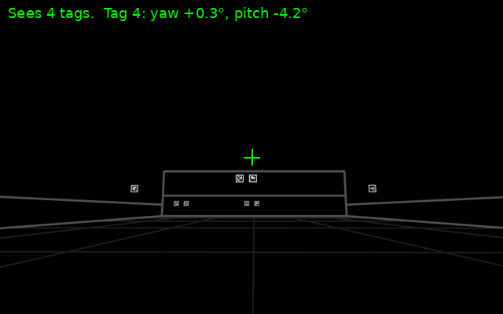
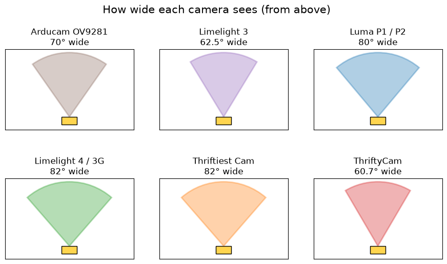
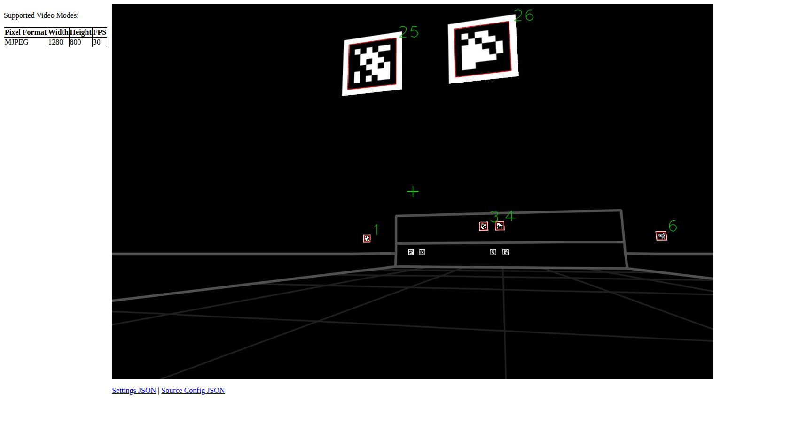
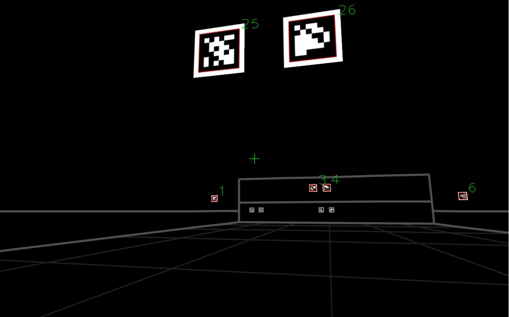
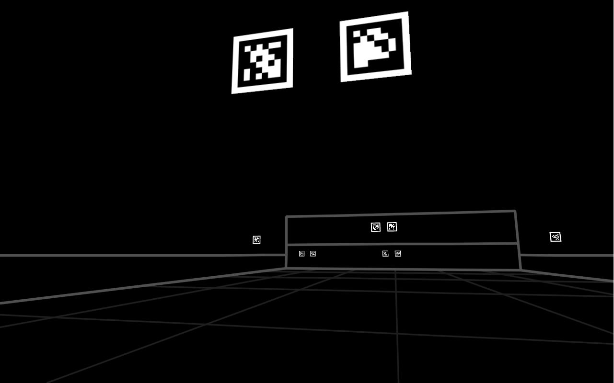

# Simulating Cameras

**Simulation** runs your robot program on your computer, with a pretend robot and field. In this tutorial you match the simulated camera to your real one and look through its eyes.

## Before you start

* Finish [Basic Setup](basic-setup.md).
* Simulation works for every camera, whatever its vendor. YALL simulates them all with PhotonVision's camera simulation, which is why PhotonLib is needed even if you only use Limelights. Thanks to the PhotonVision project for it.

## How it works

* Every camera joins a simulated world, [`VisionSim`](https://yall.yassrobotics.com/api-reference/java-reference/sim/vision-sim): a pretend field with the season's AprilTags.
* Each camera gets its own pretend camera in that world, with your camera's lens. `camera.getCameraSim()` returns it (a PhotonVision `PhotonCameraSim`), for PhotonVision settings YALL doesn't cover; it's empty on the real robot.
* Every loop, you tell the world where the robot **really** is.
* Each camera that is due a picture works out what it would see from there, adds a little noise and **latency** (the delay between taking a picture and the result reaching your code), and hands your code the result.
* Your code reads it with the same `update()` it uses on the real robot. Nothing else changes.





### Update the world every loop

In `Robot.java`:

```java
@Override
public void simulationPeriodic() {
  VisionSim.getDefault().update(simulatedRobotPose);
}
```

Give it the robot's **true** pose: your drivetrain simulation's pose, never the pose estimator's guess. With several cameras in a [`VisionSystem`](https://yall.yassrobotics.com/api-reference/java-reference/yall/vision-system), call `vision.updateSimulation(truePose)` instead.

**Check it:** `YALL/<camera name>/targetCount` goes above 0 when the robot faces AprilTags.



### Tell YALL which camera you have

Cameras see different amounts of the field. Pick yours, so the simulation sees what the real one would:

```java
config.withCameraModel(CameraModel.LIMELIGHT_3G);
```

| [`CameraModel`](https://yall.yassrobotics.com/api-reference/java-reference/sim/camera-model) | Camera | Resolution | Field of view (wide × tall) | Frames per second |
| --- | --- | --- | --- | --- |
| `LIMELIGHT_2` | [Limelight 2](https://docs.limelightvision.io/docs/docs-limelight/getting-started/limelight-2) (discontinued) | 1280x960 | 62.5° × 48.9° | 6 |
| `LIMELIGHT_2_PLUS` | [Limelight 2+](https://docs.limelightvision.io/docs/docs-limelight/getting-started/limelight-2) (discontinued) | 1280x960 | 62.5° × 48.9° | 7 |
| `LIMELIGHT_3` | [Limelight 3](https://limelightvision.io/products/limelight-3) | 1280x960 | 62.5° × 48.9° | 20 |
| `LIMELIGHT_3A` | [Limelight 3A (USB)](https://limelightvision.io/products/limelight-3a) | 1280x960 | 54.5° × 42° | 20 |
| `LIMELIGHT_3G` | [Limelight 3G](https://limelightvision.io/products/limelight-3g) | 1280x800 | 82° × 56.2° | 20 |
| `LIMELIGHT_4` | [Limelight 4](https://limelightvision.io/products/limelight-4) | 1280x800 | 82° × 56.2° | 40 |
| `LUMA_P1` | [Luma P1](https://luma.vision/products/p1) (replaced by the P2) | 1280x800 | 80° × 56° | 60 |
| `LUMA_P2` | [Luma P2](https://luma.vision/products/luma-p2) | 1280x800 | 80° × 56° | 60 |
| `THRIFTYCAM` | [ThriftyCam](https://www.thethriftybot.com/products/thriftycam) | 1600x1304 | 60.7° × 51° | 70 |
| `THRIFTIEST_CAM` | [Thriftiest Cam](https://www.thethriftybot.com/products/thriftiest-cam) | 1280x800 | 82° × 56° | 120 |
| `ARDUCAM_OV9281` | [Arducam OV9281 (B0332)](https://www.arducam.com/product/arducam-120fps-global-shutter-usb-camera-board-1mp-720p-ov9281-uvc-webcam-module-with-low-distortion-m12-lens-without-microphones-for-computer-laptop-android-device-and-raspberry-pi/) | 1280x800 | 70° × 47.3° | 100 |
| `ELP_FISHEYE` | [AndyMark ELP Fisheye Lens Camera](https://andymark.com/products/elp-fisheye-lens-camera) | 1280x960 | 115° × 99.4° | 20 |



Where these numbers come from:

* **Frame rates:** Limelights and Lumas use the AprilTag rate their makers publish. USB cameras (ThriftyCam, Thriftiest Cam, Arducam) use their top picture rate; the computer they plug into may track AprilTags slower.
* **Limelight 3G:** Limelight lists its AprilTag rate at 1280x960, which its 1280x800 sensor can't make, so it's simulated at 1280x800.
* **ThriftyCam:** its lens is rated 71° × 48° on a different sensor size. On the ThriftyCam's own sensor, its 4.1 mm lens sees 60.7° × 51°.
* **Arducam OV9281:** Arducam gives only how wide it sees (70°), so how tall comes from its 16:10 sensor. Arducam's manual says 120 frames per second and sellers say 100.
* **ELP fisheye:** its lens sees 180°, but the simulator can only make a normal (not fisheye) lens, which can't see that wide. So the model copies how big things look in the middle of the fisheye picture: that gives 115° × 99.4°. Tags in the middle look the right size; tags at the far edges of the real camera's view aren't simulated.
* **Latency:** no maker publishes one, so each model uses an estimate. Limelights report their real latency on the robot.

Without a model, a Limelight is simulated as a Limelight 4, and PhotonVision and Synapse cameras as an Arducam OV9281.

**Check it:** the project builds.



### See what the camera sees

PhotonVision can draw what each simulated camera sees and stream it like a real camera. Drawing costs a lot of computer power, so it's off until you turn it on:

```java
config
    .withSimulatedVideoStreams(true)  // draw the AprilTags the camera sees
    .withSimulatedWireframe(true);    // also draw the field's floor and walls (costs more)
```

Run the simulation, then open the stream in a web browser:

* `http://localhost:1181`: the **raw** stream, the plain picture.
* `http://localhost:1182`: the **processed** stream, with each AprilTag outlined in red, its ID in green, and the crosshair.

Each stream gets the next port number (1181, 1182, 1183, and so on) in the order the cameras are made. A PhotonVision camera named `front` streams as `front-raw` and `front-processed`; a Limelight or Synapse camera's streams are named `YALL-<camera name>-raw` and `YALL-<camera name>-processed`. A dashboard's camera stream widget shows them too.







**Check it:** the processed stream shows AprilTags with green ID numbers.

Turn both settings off again when you're done looking: they slow the simulation down.




**Why `Robot.java`?** YALL doesn't use the command framework, so it works the same with Commands v2 and Commands v3. Both robot classes, `TimedRobot` (Commands v2) and `OpModeRobot` (Commands v3), have `robotPeriodic()`, which runs every loop, and `simulationPeriodic()`, which runs every loop in simulation. Commands v3 mechanisms have no `simulationPeriodic()`, so `Robot.java` is the one place that works for both.


## If it did not work

* **Nothing at `localhost:1181`:** `withSimulatedVideoStreams(true)` isn't set, or the simulation isn't running.
* **The stream is black:** the camera faces away from every AprilTag. With `withSimulatedWireframe(true)` you can at least see the floor.
* **`targetCount` stays 0:** [`VisionSim.getDefault().update(...)`](https://yall.yassrobotics.com/api-reference/java-reference/sim/vision-sim) isn't called in `simulationPeriodic()`.
* **More problems:** [Troubleshooting](../how-to-guides/troubleshooting.md).

## The complete file



`first/robot/Robot.java`:

```java
package first.robot;

import static org.wpilib.units.Units.Degrees;
import static org.wpilib.units.Units.Inches;

import org.photonvision.PhotonCamera;
import org.wpilib.framework.TimedRobot;
import org.wpilib.math.geometry.Pose2d;
import org.wpilib.math.geometry.Rotation2d;
import yall.VisionCamera;
import yall.VisionCameraConfig;
import yall.cameras.PhotonVisionWrapper;
import yall.sim.CameraModel;
import yall.sim.VisionSim;

public class Robot extends TimedRobot {
  private static final Pose2d SIMULATED_ROBOT_POSE = new Pose2d(3.0, 4.0, Rotation2d.ZERO);

  private final VisionCamera camera =
      new PhotonVisionWrapper(
          new PhotonCamera("front"),
          new VisionCameraConfig()
              .withCameraModel(CameraModel.LUMA_P1)
              .withRobotToCamera(
                  Inches.zero(), Inches.zero(), Inches.of(20),
                  Degrees.zero(), Degrees.of(-10), Degrees.zero())
              // Show what the simulated camera sees. Costs CPU: turn off when done.
              .withSimulatedVideoStreams(true)
              // Also draw the field's floor and walls. Costs more CPU.
              .withSimulatedWireframe(true));

  @Override
  public void robotPeriodic() {
    camera.update();
  }

  @Override
  public void simulationPeriodic() {
    VisionSim.getDefault().update(SIMULATED_ROBOT_POSE);
  }
}
```



`first/robot/Robot.java`:

```java
package first.robot;

import static org.wpilib.units.Units.Degrees;
import static org.wpilib.units.Units.Inches;

import org.photonvision.PhotonCamera;
import org.wpilib.framework.OpModeRobot;
import org.wpilib.math.geometry.Pose2d;
import org.wpilib.math.geometry.Rotation2d;
import yall.VisionCamera;
import yall.VisionCameraConfig;
import yall.cameras.PhotonVisionWrapper;
import yall.sim.CameraModel;
import yall.sim.VisionSim;

public class Robot extends OpModeRobot {
  private static final Pose2d SIMULATED_ROBOT_POSE = new Pose2d(3.0, 4.0, Rotation2d.ZERO);

  private final VisionCamera camera =
      new PhotonVisionWrapper(
          new PhotonCamera("front"),
          new VisionCameraConfig()
              .withCameraModel(CameraModel.LUMA_P1)
              .withRobotToCamera(
                  Inches.zero(), Inches.zero(), Inches.of(20),
                  Degrees.zero(), Degrees.of(-10), Degrees.zero())
              // Show what the simulated camera sees. Costs CPU: turn off when done.
              .withSimulatedVideoStreams(true)
              // Also draw the field's floor and walls. Costs more CPU.
              .withSimulatedWireframe(true));

  @Override
  public void robotPeriodic() {
    camera.update();
  }

  @Override
  public void simulationPeriodic() {
    VisionSim.getDefault().update(SIMULATED_ROBOT_POSE);
  }
}
```



## More about simulation

### The debug field

[`VisionSim.getDefault().getDebugField()`](https://yall.yassrobotics.com/api-reference/java-reference/sim/vision-sim) returns a `Field2d` with the robot, the cameras and the targets they see. PhotonVision also publishes it as `VisionSystemSim-YALL/Sim Field`.

### Any other camera

For a camera that isn't in the table, give its size, how wide it sees corner to corner (diagonal field of view) and its frame rate:

```java
config.withCameraProperties(1280, 720, Degrees.of(70), Hertz.of(30));
```

or pass PhotonVision's `SimCameraProperties`, for example a model with a slower frame rate:

```java
var properties = CameraModel.ARDUCAM_OV9281.getSimCameraProperties();
properties.setFPS(30); // what your computer tracks AprilTags at
config.withCameraProperties(properties);
```

Synapse also uses these numbers on the real robot, to turn its pixel positions into angles, so set them to match the real camera.

### Another field

The default world uses WPILib's `Fields.DEFAULT_FIELD`. For another field, replace the world before making cameras, and give the cameras the same field:

```java
Field field = Field.loadField(Fields.FRC_2026_REBUILT_WELDED);
VisionSim.setDefault(new VisionSim("YALL", field));
config.withField(field);
```

Give one camera its own world with `config.withSimulation(myVisionSim)`, or turn its simulation off with `config.withSimulation(false)` to read a real camera from a laptop.

### Game pieces

See [Object Detection](object-detection.md).

### Unit tests

Simulation runs in JUnit tests too. Pause the clock and step it yourself:

```java
HAL.initialize();
SimHooks.pauseTiming();
for (int i = 0; i < 50; i++) {
  SimHooks.stepTiming(0.02);
  vision.updateSimulation(robotPose);
  vision.update();
}
```

YALL's [example robot](https://github.com/Yet-Another-Software-Suite/YALL/tree/main/examples/kitbot) has a test like this. PhotonVision's own simulation docs are at [Simulation](https://docs.photonvision.org/en/latest/docs/simulation/index.html).
