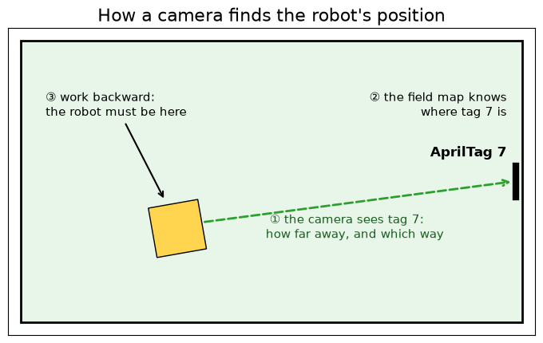
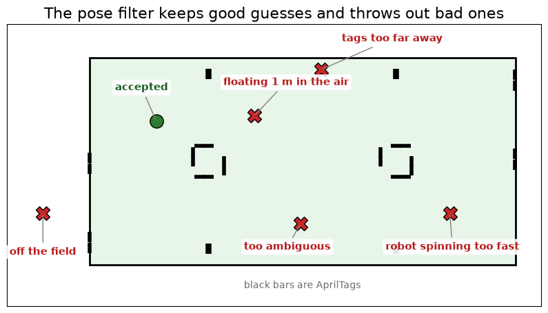
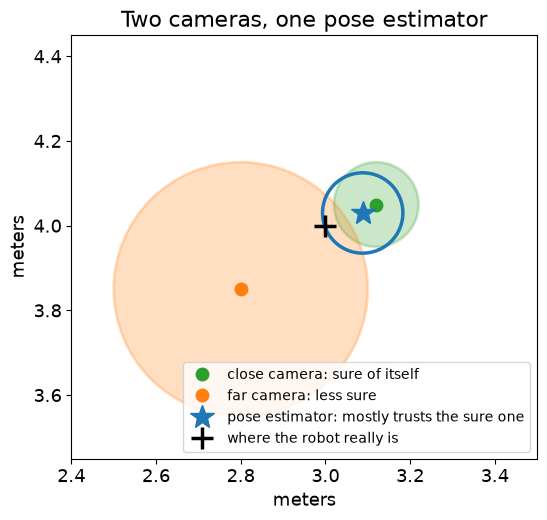

# Pose Estimation & Filtering

A **pose estimate** is a camera's guess at where the robot is. This page explains where the guesses come from, why some get thrown out, and how much the rest are trusted.



## Where an estimate comes from

Each camera frame with AprilTags can produce one [`VisionPoseEstimate`](https://yall.yassrobotics.com/api-reference/java-reference/results/vision-pose-estimate). How the wrapper makes it depends on the vendor and the [pose estimation mode](../how-to-guides/how-do-i-choose-a-pose-estimation-mode.md):

| Source | `TAGS_ONLY` | `HEADING_ASSISTED` |
| --- | --- | --- |
| Limelight | MegaTag1, blue origin | MegaTag2, blue origin |
| PhotonVision | PhotonVision's coprocessor multi-tag result, then the lowest-ambiguity tag | PnP distance trig solve, then `TAGS_ONLY` |
| Synapse | Synapse's field-space camera pose, moved to the robot with the camera offset | same as `TAGS_ONLY` |
| Simulation, any vendor | PhotonVision's multi-tag result, then the lowest-ambiguity tag | PnP distance trig solve, then `TAGS_ONLY` |

Every estimate is in WPILib's blue-origin field coordinates, whatever the alliance.

## What an estimate holds

| Field | Meaning |
| --- | --- |
| `cameraName()` | The camera that produced it |
| `pose()` / `pose2d()` | The robot pose, in 3D or on the floor |
| `timestampSeconds()` | When the image was captured, on `Timer.getMonotonicTimestamp()`'s timebase |
| `tagIds()` / `tagCount()` | The AprilTags used |
| `averageTagDistanceMeters()` | Average camera-to-tag distance |
| `ambiguity()` | Single-tag pose ambiguity, 0 to 1. 0 for multi-tag estimates, NaN when the camera doesn't report it (Synapse) |
| `headingAssisted()` | Whether the heading came from the gyro |
| `stdDevs()` | x and y (meters) and heading (radians) standard deviations, for `addVisionMeasurement` |

Always pass `timestampSeconds()` to `addVisionMeasurement`, never the current time. The pose estimator uses it to apply the measurement where the robot was when the image was taken.

## Why filter

Not every estimate is trustworthy. A single distant tag seen at a sharp angle can produce a pose that is present but wildly wrong. A single tag can also have two nearly equal solutions, one of them flipped (ambiguity). Feeding those to a pose estimator makes the robot's pose jump.

## The filter



Every estimate goes through the camera's [`VisionPoseFilter`](https://yall.yassrobotics.com/api-reference/java-reference/filter/vision-pose-filter) in `update()`. The first failing check rejects it; the rest go to `getEstimatedPoses()`. Checks run in this order:

| Check | Default | Rejects when |
| --- | --- | --- |
| No tags | always on | no tags were used |
| Tag count | 1 | fewer tags were used |
| Age | 0.5 s | the image is older than the limit, or more than 50 ms in the future |
| Field bounds | 0.5 m | x or y is more than the margin outside the field |
| Height | 0.5 m | `|z|` is above the limit |
| Tilt | off | roll or pitch is above the limit |
| Ambiguity | 0.2 | a single-tag estimate's known ambiguity is above the limit |
| Tag distance | 4 m single, 8 m multi | the average tag distance is above the limit for its tag count |
| Yaw rate | 720 °/s | the last yaw rate from `setRobotOrientation` is above the limit |
| Pose jump | off | the estimate is further than the limit from the current pose |

Field bounds use the field from the camera's config (`withField`), which defaults to WPILib's `Fields.DEFAULT_FIELD`.

Every check except "no tags" turns off with `null`. See [How do I tune the pose filter?](../how-to-guides/how-do-i-tune-the-pose-filter.md)

### Your own checks

After the built-in checks, the filter runs any checks you add with `withCustomCheck`. Each needs a name: it becomes the rejection reason, and the filter stats count that check's rejections under it, so you can always see which check threw out what.

```java
filter.withCustomCheck("not in our half", estimate -> estimate.pose().getX() < 8.27);
```

### Counting what it decides

Each camera's [`PoseFilterStats`](https://yall.yassrobotics.com/api-reference/java-reference/filter/pose-filter-stats) counts what its filter accepts and rejects, by check, and measures how much the accepted poses wobble. That wobble is the camera's real standard deviation. See [Measuring Standard Deviations](../tutorials/measuring-standard-deviations.md).

## Standard deviations

A **standard deviation** says how far off a guess might be. The pose estimator moves the robot's position a lot for a guess with a small standard deviation, and barely at all for one with a big standard deviation.

Accepted estimates get standard deviations that grow with the square of the tag distance:

```
stdDev = base * (1 + d² / 30)
```

* The base is `(4 m, 4 m, 8 rad)` for one tag and `(0.5 m, 0.5 m, 1 rad)` for several: more tags constrain the solve better.
* `d` is the average tag distance in meters. A tag 3 m away scales the base by 1.3; one 6 m away by 2.2.
* Heading-assisted estimates get a heading standard deviation of 1,000,000 rad, so the pose estimator ignores their heading, which is the gyro's anyway.

Change all of these with `withStdDevs(...)` and `withHeadingAssistedThetaStdDev(Radians.of(...))`.

## Limelight's own filter

A Limelight given a `PoseEstimateConfig` through `withVendorConfig` uses Limelight's rejection rules and standard deviations instead of YALL's. See [How do I use vendor-specific settings?](../how-to-guides/how-do-i-use-vendor-specific-settings.md#pose-estimate-config)

## Several cameras



[`VisionSystem.addVisionMeasurements`](https://yall.yassrobotics.com/api-reference/java-reference/yall/vision-system) adds every camera's accepted estimates to your pose estimator, oldest first, one at a time. The pose estimator weighs each one by its standard deviations, so more trusted estimates pull harder, and applies each at the time its image was taken. Don't combine the cameras' estimates yourself first: that loses their timestamps and standard deviations. See [How do I use multiple cameras?](../how-to-guides/how-do-i-use-multiple-cameras.md#how-to-use-addvisionmeasurement)

## Read more

* [AprilTag Pose Estimation tutorial](../tutorials/apriltag-pose-estimation.md)
* [AprilTag Localization Tuning](../tuning/apriltag-and-megatag2-tuning.md)
* [ChArUco Camera Calibration](../tuning/charuco-camera-calibration.md): accurate intrinsics are what make the estimates accurate in the first place.
