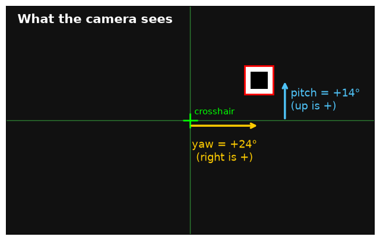

# Results Model

Every camera, whatever its maker, reports what it saw the same way, with three kinds of result:

* a **frame** (`VisionResult`): one picture the camera processed;
* a **target** (`VisionTarget`): one thing in that picture, like an AprilTag or a game piece;
* a **pose estimate** (`VisionPoseEstimate`): where the camera thinks the robot is.

They live in the `yall.results` package.

## `VisionResult`: one frame

| Field | Meaning |
| --- | --- |
| `cameraName()` | The camera that produced it |
| `timestampSeconds()` | When the image was captured, on `Timer.getMonotonicTimestamp()`'s timebase |
| `latencyMillis()` | Time from capture to the result reaching the robot |
| `targets()` | Targets in the frame, best first |

Helpers: `hasTargets()`, `getBestTarget()`, `getAprilTags()`, `getDetectedObjects()`.

A camera's `update()` reads every frame since the last call. `getUnreadResults()` returns them, oldest first; `getLatestResult()` returns the newest frame ever read.

## `VisionTarget`: one target

| Field | Meaning |
| --- | --- |
| `yawDegrees()` | Horizontal angle from the crosshair, **positive right** |
| `pitchDegrees()` | Vertical angle from the crosshair, **positive up** |
| `areaPercent()` | Share of the image covered, 0 to 100. NaN when not reported |
| `fiducialId()` | AprilTag ID, or -1 |
| `classId()` | Object detection class ID, or -1 |
| `confidence()` | Object detection confidence, 0 to 1 |
| `ambiguity()` | AprilTag pose ambiguity, 0 to 1. NaN when not reported |
| `cameraToTarget()` | Transform from the camera to the target, when the camera solved one |

Helpers: `isAprilTag()`, `isDetectedObject()`.

## `VisionPoseEstimate`: one robot pose

See [Pose Estimation & Filtering](pose-estimation-and-filtering.md#what-an-estimate-holds).

## What each vendor reports

| | Limelight | PhotonVision | Synapse |
| --- | --- | --- | --- |
| Yaw | `tx`, passed through | yaw, passed through | pixel x, turned into an angle with the camera properties |
| Pitch | `-ty` (Limelight's per-target `ty` is positive down) | pitch, passed through | pixel y, turned into an angle with the camera properties |
| Area | yes | yes | NaN |
| AprilTags | yes, with ambiguity and camera-to-tag transform | yes, with ambiguity and camera-to-tag transform | IDs and angles only; no area, ambiguity or transform |
| Object detection | neural detector: class ID and confidence | object detection pipeline: class ID and confidence | not in Synapse's Java library |
| Color / retroreflective | retroreflective targets, no ID | color targets, no ID | color pipeline targets, no ID |
| Not mapped | classifier, barcode, OCR | none | none |
| Timestamp | LimelightLib's receive time minus capture and targeting latency | PhotonVision's time-synced capture time | NetworkTables arrival time minus Synapse's capture and process latency |

When you compare a YALL pitch to a raw Limelight `ty`, flip the sign: YALL's pitch is the negative of Limelight's per-target `ty`.

Synapse reports target positions in pixels. YALL turns them into angles with the camera properties in the config, so set them to match the real camera with `withCameraModel` or `withCameraProperties`.

For results YALL doesn't map, use the vendor's library through `getCamera()`. See [How do I use vendor-specific settings?](../how-to-guides/how-do-i-use-vendor-specific-settings.md)

## Read more

* [Basic Setup](../tutorials/basic-setup.md#read-the-camera-every-loop)
* [Object Detection](../tutorials/object-detection.md)
