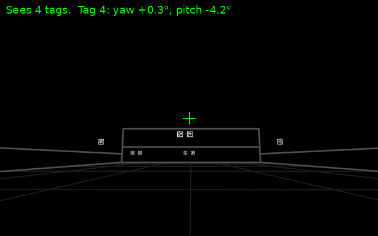

# Why YALL?

## One API for every camera

PhotonVision, Limelight and Synapse each have their own library, and each one names things differently, measures angles differently and times its pictures differently. Switching cameras, or using two kinds on one robot, means writing your vision code twice. YALL lets you write it once.

YALL wraps each vendor's camera object in a `VisionCamera`, the way YAMS wraps motor controllers:

```java
VisionCamera front = new PhotonVisionWrapper(new PhotonCamera("front"), frontConfig);
VisionCamera back = new LimelightWrapper(new Limelight("limelight-back"), backConfig);
VisionCamera side = new SynapseWrapper(new SynapseCamera("side"), sideConfig);
```

Every camera then reads the same way:

* **Targets** come back as `VisionTarget`: yaw, pitch, area, AprilTag ID, object class and confidence.
* **Robot poses** come back as `VisionPoseEstimate`: pose, capture timestamp, tags used, tag distance, ambiguity and standard deviations.
* **Pipelines, connection state and the camera's position on the robot** use the same methods for every vendor.

## Simulation for every vendor

Limelight and Synapse have no simulation of their own. YALL simulates every camera with PhotonVision's camera simulation: it works out what each camera would see from where the robot is, with a little noise and delay like a real camera. You can even watch it:



## Pose filtering built in

Every pose estimate (a camera's guess at where the robot is) goes through a `VisionPoseFilter` before your code sees it. It rejects estimates that are off the field, off the floor, too ambiguous, from tags too far away, taken while spinning, or too old. Each check has a default, can be tuned, and turns off when you pass `null`. Accepted estimates get standard deviations that grow with tag distance and shrink with tag count, ready for `addVisionMeasurement`. See [Pose Estimation & Filtering](understanding/pose-estimation-and-filtering.md).

## Several cameras, one pose

`VisionSystem` updates every camera and feeds each accepted estimate to your pose estimator, oldest first. `getFusedPose()` combines the cameras' newest estimates into one pose, weighted by how much each is trusted. See [How do I use multiple cameras?](how-to-guides/how-do-i-use-multiple-cameras.md)

## The vendor library is still there

YALL covers what the vendors have in common. For everything else, `getCamera()` returns the vendor's own camera object, and `withVendorConfig(...)` passes vendor config objects through. See [How do I use vendor-specific settings?](how-to-guides/how-do-i-use-vendor-specific-settings.md)

## Telemetry you can see

Each camera publishes its accepted and rejected poses, why it last rejected one, its target count, latency and connection state under `YALL/<camera name>` in NetworkTables. Plot the accepted and rejected poses on a field in AdvantageScope or Elastic to see the filter working. See [Telemetry](understanding/telemetry.md).
