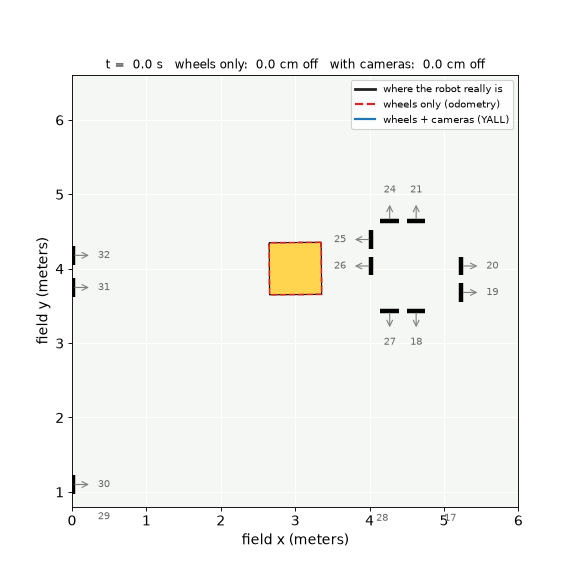

# Yet Another Limelight Library

**YALL** helps an FRC robot use its cameras to know where it is on the field and to find targets. It works with **PhotonVision**, **Limelight** and **Synapse** cameras, and your code reads all of them the same way.



The black line is where a simulated robot really drove. Red is where it thinks it is from its wheels alone: it drifts. Blue adds three cameras through YALL and stays on track.

* **Works with every camera:** PhotonVision, Limelight and Synapse cameras, read the same way.
* **Test without a robot:** in simulation, YALL pretends to be each camera, using the published specs of every [Limelight](https://limelightvision.io/collections/products), the [Luma P1](https://luma.vision/products/p1) and [P2](https://luma.vision/products/luma-p2), the [ThriftyCam](https://www.thethriftybot.com/products/thriftycam), [Thriftiest Cam](https://www.thethriftybot.com/products/thriftiest-cam), [Arducam OV9281](https://andymark.com/products/arducam-camera) and [AndyMark ELP fisheye camera](https://andymark.com/products/elp-fisheye-lens-camera).
* **Throws out bad guesses:** a pose filter rejects camera guesses that can't be right, says how much to trust the rest, and counts what it threw out and why.
* **Many cameras, one answer:** feed every camera's guesses to WPILib's pose estimator, or combine them into one.
* **Nothing hidden:** you can still reach each camera maker's own library.

<table data-view="cards"><thead><tr><th></th><th></th><th></th><th data-hidden data-card-target data-type="content-ref"></th></tr></thead><tbody><tr><td><h4><i class="fa-book" style="color:$primary;">:book:</i></h4></td><td><strong>Documentation</strong></td><td>Tutorials, how-to guides, tuning, and explanations for using YALL on your robot.</td><td><a href="https://app.gitbook.com/o/MwECAyhaWCMK5V9K79gd/s/xvbH7hsvI1wbJLmWKbYA/">Documentation</a></td></tr><tr><td><h4><i class="fa-terminal" style="color:$primary;">:terminal:</i></h4></td><td><strong>API Reference</strong></td><td>Every class, field, and method, organized by package.</td><td><a href="https://app.gitbook.com/o/MwECAyhaWCMK5V9K79gd/s/SeN5mmDroa8PGOxzfk2Q/">API Reference</a></td></tr><tr><td><h4><i class="fa-github" style="color:$primary;">:github:</i></h4></td><td><strong>Source</strong></td><td>Source code, issues, and releases.</td><td><a href="https://github.com/Yet-Another-Software-Suite/YALL">https://github.com/Yet-Another-Software-Suite/YALL</a></td></tr></tbody></table>

## Install

YALL works with WPILib 2027. Add these vendordeps (libraries) in WPILib VS Code with **WPILib: Manage Vendor Libraries**:

1. YALL: `https://Yet-Another-Software-Suite.github.io/YALL/yall.json`
2. PhotonLib, which YALL simulates with.
3. WPILib's **CameraServer** and **AprilTag**, which come with WPILib.
4. Your cameras' own libraries: LimelightLib 2 for Limelights, SynapseLib for Synapse.

The Documentation section's **How do I install YALL?** page walks through each one.

## Quick example

One camera, in `Robot.java`. This works the same with Commands v2 (`TimedRobot`) and Commands v3 (`OpModeRobot`):

```java
private final VisionCamera camera =
    new PhotonVisionWrapper(  // or LimelightWrapper / SynapseWrapper
        new PhotonCamera("front"),
        new VisionCameraConfig()
            .withCameraModel(CameraModel.ARDUCAM_OV9281)    // which camera it is
            .withRobotToCamera(Inches.of(12), Inches.zero(), Inches.of(10),
                               Degrees.zero(), Degrees.of(-15), Degrees.zero())); // where it sits

@Override
public void robotPeriodic() {
  camera.setRobotOrientation(poseEstimator.getEstimatedPosition().getRotation());
  camera.update();
  camera.addVisionMeasurements(poseEstimator);
}

@Override
public void simulationPeriodic() {
  VisionSim.getDefault().update(simulatedTruePose);
}
```

## Part of Yet Another Software Suite

YALL is one of several FRC libraries from **Yet Another Software Suite**, alongside [YAGSL](https://github.com/Yet-Another-Software-Suite/YAGSL) (swerve drive) and [YAMS](https://github.com/Yet-Another-Software-Suite/YAMS) (mechanisms).
